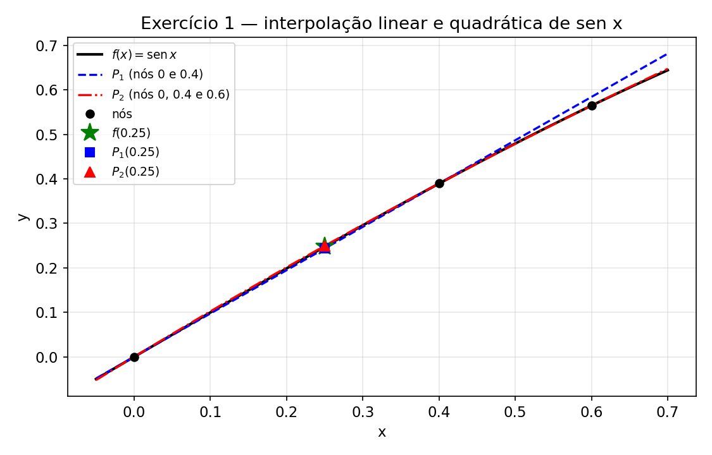
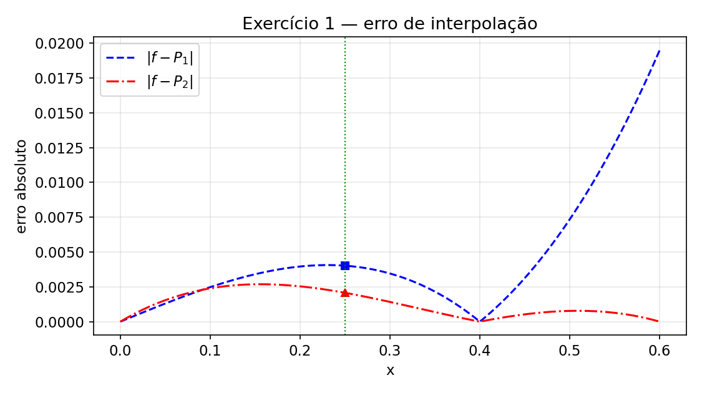
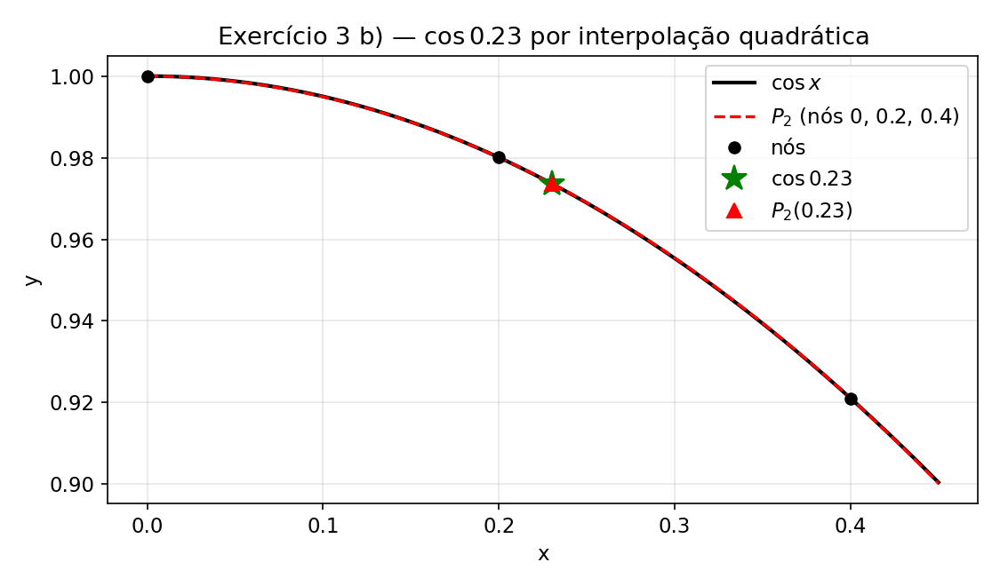
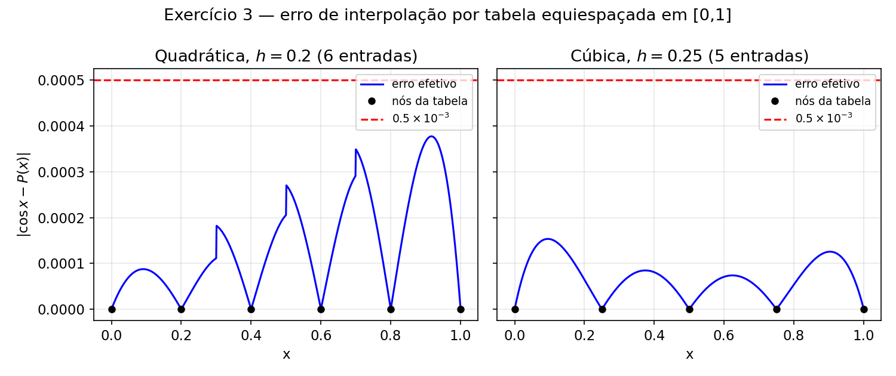
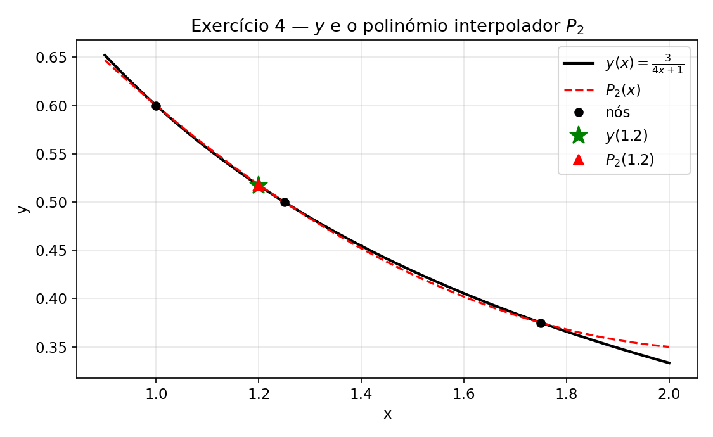

# Ficha 2 - Interpolação polinomial
[[ExerciciosInterpolacao.pdf]]
Exercícios resolvidos: **1; 3; 4**


---

## 0. Resumo teórico (para consulta)

### Forma de Lagrange

Dados $n+1$ pontos $(x_i,y_i)$, $i=0,\dots,n$, com $x_i$ distintos, o polinómio interpolador de grau $\le n$ é

$$P_n(x)=\sum_{i=0}^{n}y_i\,L_i(x),\qquad L_i(x)=\prod_{\substack{j=0\\j\neq i}}^{n}\frac{x-x_j}{x_i-x_j}$$

(Cada $L_i$ vale $1$ em $x_i$ e $0$ nos restantes nós.)

### Erro de interpolação

Se $f\in C^{n+1}$, para cada $x$ existe $\xi$ no menor intervalo que contém $x,x_0,\dots,x_n$ tal que

$$f(x)-P_n(x)=\frac{f^{(n+1)}(\xi)}{(n+1)!}\,\omega(x),\qquad\omega(x)=\prod_{i=0}^{n}(x-x_i)$$

**Majorante:**

$$|f(x)-P_n(x)|\le\frac{M_{n+1}}{(n+1)!}\,|\omega(x)|,\qquad M_{n+1}=\max_{\xi\in I}|f^{(n+1)}(\xi)|$$

### Forma de Newton com diferenças divididas

$$f[x_i]=f(x_i),\qquad f[x_i,\dots,x_{i+k}]=\frac{f[x_{i+1},\dots,x_{i+k}]-f[x_i,\dots,x_{i+k-1}]}{x_{i+k}-x_i}$$

$$P_n(x)=f[x_0]+f[x_0,x_1](x-x_0)+f[x_0,x_1,x_2](x-x_0)(x-x_1)+\cdots+f[x_0,\dots,x_n]\prod_{i=0}^{n-1}(x-x_i)$$

- **Erro:** $f(x)-P_n(x)=f[x_0,\dots,x_n,x]\;\omega(x)$.
- **Relação com derivadas:** $f[x_0,\dots,x_k]=\dfrac{f^{(k)}(\xi)}{k!}$, com $\xi$ no menor intervalo que contém os nós.

---

## 1)

**Enunciado:** $x_1=0.0,\ x_2=0.4,\ x_3=0.6$; aproximar $f(x)=\operatorname{sen}x$ em $\bar x=0.25$.

### a) Interpolação linear (forma de Lagrange)

Escolhem-se os dois nós **que enquadram** $\bar x$: $x_1=0$ e $x_2=0.4$ (com nós de um só lado, $|\omega(\bar x)|$ seria maior — estaríamos a extrapolar).

$$P_1(x)=y_1L_1(x)+y_2L_2(x),\quad L_1(x)=\frac{x-x_2}{x_1-x_2},\ L_2(x)=\frac{x-x_1}{x_2-x_1}$$

```m
x = [0 0.4];
y = sin(x);
xbar = 0.25;
L1 = (xbar - x(2)) / (x(1) - x(2));
L2 = (xbar - x(1)) / (x(2) - x(1));
L = [L1 L2];
valAprox = L * y'
```

```m
valAprox = 0.2434
```

(Aqui $L_1(0.25)=0.375$ e $L_2(0.25)=0.625$, logo $P_1(0.25)=0.625\cdot\operatorname{sen}(0.4)$.)

### b) Majorante do erro e comparação

Erro efetivamente cometido:

```m
valExato = sin(xbar);
erro = abs(valAprox - valExato)
```

```m
erro = 0.0040
```

Majorante: $f''(x)=-\operatorname{sen}x$, e em $[0,0.4]$ tem-se $|f''(\xi)|\le\operatorname{sen}(0.4)$:

$$|E|\le\frac{\operatorname{sen}(0.4)}{2!}\,|(\bar x-x_1)(\bar x-x_2)|$$

```m
majorante = (sin(0.4) / 2) * abs((xbar - x(1)) * (xbar - x(2)))
```

```m
majorante = 0.0073
```

A aproximação é $0.2434$, um majorante para o erro é $0.0073$ e o erro cometido é $0.0040$ (o majorante é cerca do dobro do erro real: é uma **cota**, não uma estimativa exata).

### c) Interpolação quadrática (3 nós)

```m
xb = [0 0.4 0.6];
yb = sin(xb);
L1b = (xbar - xb(2)) * (xbar - xb(3)) / ((xb(1) - xb(2)) * (xb(1) - xb(3)));
L2b = (xbar - xb(1)) * (xbar - xb(3)) / ((xb(2) - xb(1)) * (xb(2) - xb(3)));
L3b = (xbar - xb(1)) * (xbar - xb(2)) / ((xb(3) - xb(1)) * (xb(3) - xb(2)));
Lb = [L1b L2b L3b];
valAproxb = Lb * yb'
errob = abs(valAproxb - valExato)      % <-- usar valAproxb (e não valAprox)
majoranteb = abs((xbar - xb(1)) * (xbar - xb(2)) * (xbar - xb(3))) / 6
```

```m
valAproxb = 0.2495
errob = 0.0021
majoranteb = 0.0022
```


Majorante: $f'''(x)=-\cos x$, $|f'''|\le1$ em $[0,0.6]$ (máximo em $x=0$):

$$|E|\le\frac{1}{3!}\,|(0.25-0)(0.25-0.4)(0.25-0.6)|=\frac{0.013125}{6}\approx0.0022$$

**Comparação:**

| | Aproximação | Erro efetivo | Majorante |
|---|---|---|---|
| Linear ($P_1$) | $0.2434$ | $0.0040$ | $0.0073$ |
| Quadrática ($P_2$) | $0.2495$ | $0.0021$ | $0.0022$ |

Valor exato: $\operatorname{sen}(0.25)=0.2474$. O erro desce para cerca de metade ao passar de grau 1 para grau 2.

### Gráficos (Matlab)

```m
f  = @(x) sin(x);
xb = 0.25;
x2 = [0 0.4];      p1 = polyfit(x2, f(x2), 1);   % interpolador linear
x3 = [0 0.4 0.6];  p2 = polyfit(x3, f(x3), 2);   % interpolador quadrático

xx = linspace(-0.05, 0.7, 400);
figure; hold on; grid on
plot(xx, f(xx), 'k', 'LineWidth', 2)
plot(xx, polyval(p1, xx), 'b--', 'LineWidth', 1.5)
plot(xx, polyval(p2, xx), 'r-.', 'LineWidth', 1.5)
plot(x3, f(x3), 'ko', 'MarkerFaceColor', 'k')       % nós
plot(xb, f(xb), 'g*', 'MarkerSize', 10)             % valor exato
plot(xb, polyval(p1, xb), 'bs')                     % P1(0.25)
plot(xb, polyval(p2, xb), 'r^')                     % P2(0.25)
legend('sen x', 'P_1', 'P_2', 'nós', 'f(0.25)', 'P_1(0.25)', 'P_2(0.25)', 'Location', 'northwest')
xlabel('x'); ylabel('y'); title('Exercício 1 - sen x, P_1 e P_2')
```



Gráfico do **erro absoluto** de cada interpolador:

```m
xe = linspace(0, 0.6, 500);
figure; hold on; grid on
plot(xe, abs(f(xe) - polyval(p1, xe)), 'b--')
plot(xe, abs(f(xe) - polyval(p2, xe)), 'r-.')
plot(xb, abs(f(xb) - polyval(p1, xb)), 'bs')
plot(xb, abs(f(xb) - polyval(p2, xb)), 'r^')
legend('|f - P_1|', '|f - P_2|')
xlabel('x'); ylabel('erro absoluto')
```



Repara que $P_1$ só é "razoável" entre os seus nós ($0$ e $0.4$); fora desse intervalo o erro cresce rapidamente (extrapolação). Os erros anulam-se nos nós.

---

## 3)

**Enunciado:** tabela de $f(x)=\cos x$ em pontos igualmente espaçados (passo $h$) em $[0,1]$.

### a) Interpolação quadrática, precisão de 3 c.d. → nº mínimo de entradas

"3 casas decimais de precisão" ⟺ erro $\le0.5\times10^{-3}$.

Para **3 nós equiespaçados** $x_0,\ x_0+h,\ x_0+2h$, com $\omega(x)=(x-x_0)(x-x_0-h)(x-x_0-2h)$, o máximo de $|\omega|$ em $[x_0,x_0+2h]$ é

$$\max|\omega|=\frac{2\sqrt3}{9}\,h^3$$

(atingido em $x=x_0+h\left(1\pm\tfrac1{\sqrt3}\right)$). Como $f'''(x)=\operatorname{sen}x$, $\;M_3=\max_{[0,1]}|\operatorname{sen}x|=\operatorname{sen}1$.

$$|E|\le\frac{\operatorname{sen}(1)}{3!}\cdot\frac{2\sqrt3}{9}h^3=\frac{\sqrt3\,\operatorname{sen}(1)}{27}\,h^3\le0.5\times10^{-3}$$

$$\Longleftrightarrow\quad h^3\le\frac{0.5\times10^{-3}\times27}{\sqrt3\,\operatorname{sen}(1)}$$

```m
a=0.5*1E-3*27/(sin(1)*sqrt(3));
nthroot(a,3)
```

```m
ans = 0.2100
```

Logo $h \leq 0.21 \implies h = 0.2$ (o passo tem de ser $h=\frac1{n-1}$ para a tabela cobrir $[0,1]$: $n-1\ge\frac1{0.21}\approx4.76\Rightarrow n-1=5$).

A tabela vai precisar de **6 entradas**: $x=0,\,0.2,\,0.4,\,0.6,\,0.8,\,1$.

### b) $\cos0.23$ por interpolação quadrática (3 c.d.)

Usam-se os 3 nós da tabela mais próximos de $0.23$: $0,\ 0.2,\ 0.4$.

```m
xn = [0 0.2 0.4];
yn = cos(xn);
p = polyfit(xn, yn, 2);
aprox = polyval(p, 0.23)
erro  = abs(aprox - cos(0.23))
maj   = sin(0.4)/6 * abs(prod(0.23 - xn))
```

```m
aprox = 0.9737
erro  = 4.0196e-05
maj   = 7.6131e-05
```

Em **forma de Newton** (para confirmar à mão): $\;y[0,0.2]=-0.0997,\ y[0.2,0.4]=-0.2950,\ y[0,0.2,0.4]=-0.4884$

$$P_2(0.23)=1-0.0997(0.23)-0.4884(0.23)(0.03)\approx0.9737$$

Majorante do erro: $\dfrac{\operatorname{sen}(0.4)}{6}\,|0.23\cdot0.03\cdot0.17|\approx7.6\times10^{-5}<0.5\times10^{-3}$ ✓

$$\boxed{\cos0.23\approx0.974\quad\text{(3 c.d.)}}$$

(valor exato: $\cos0.23=0.97367\ldots$)



```m
f  = @(x) cos(x);
xx = linspace(0, 0.45, 300);
figure; hold on; grid on
plot(xx, f(xx), 'k', 'LineWidth', 2)
plot(xx, polyval(p, xx), 'r--', 'LineWidth', 1.5)
plot(xn, yn, 'ko', 'MarkerFaceColor', 'k')
plot(0.23, f(0.23), 'g*', 'MarkerSize', 10)
plot(0.23, polyval(p, 0.23), 'r^')
legend('cos x', 'P_2', 'nós', 'cos 0.23', 'P_2(0.23)')
xlabel('x'); ylabel('y')
```

### c) Interpolação cúbica → nº mínimo de entradas

Para **4 nós equiespaçados**, $\max|\omega_4|=h^4$ (atingido nos intervalos extremos), e $f^{(4)}(x)=\cos x$, $\;M_4=\max_{[0,1]}|\cos x|=1$:

$$|E|\le\frac{1}{4!}\,h^4\le0.5\times10^{-3}\;\Longleftrightarrow\;h^4\le0.012\;\Longleftrightarrow\;h\le0.3310$$

```m
nthroot(24*0.5e-3, 4)
```

```m
ans = 0.3310
```

Como $h=\frac1{n-1}\le0.331\Rightarrow n-1\ge3.02\Rightarrow n-1=4$, ou seja $h=0.25$.

A tabela deve ter **5 entradas**: $x=0,\,0.25,\,0.5,\,0.75,\,1$.

> Com $n=4$ ($h=\tfrac13$) o majorante dá $\frac{(1/3)^4}{24}\approx5.14\times10^{-4}>0.5\times10^{-3}$ — **não garante** os 3 c.d. (embora o erro real seja ~$4.6\times10^{-4}$). Daí que o mínimo *garantido* seja 5.

### Verificação gráfica (Matlab)

Para cada $x\in[0,1]$ usa-se o interpolador construído com os $(\text{grau}+1)$ nós da tabela mais próximos e desenha-se o erro efetivo, comparando-o com $0.5\times10^{-3}$:

```m
f  = @(x) cos(x);
xx = linspace(0, 1, 1001);
figure
for caso = 1:2
    if caso == 1, h = 0.2;  grau = 2; else, h = 0.25; grau = 3; end
    xt = 0:h:1;  yt = f(xt);
    err = zeros(size(xx));
    for k = 1:length(xx)
        [~, idx] = sort(abs(xt - xx(k)));      % nós por ordem de proximidade
        idx = idx(1:grau+1);                   % os grau+1 mais próximos
        p = polyfit(xt(idx), yt(idx), grau);
        err(k) = abs(f(xx(k)) - polyval(p, xx(k)));
    end
    subplot(1, 2, caso); hold on; grid on
    plot(xx, err, 'b')
    plot(xt, zeros(size(xt)), 'ko', 'MarkerFaceColor', 'k')
    plot([0 1], 0.5e-3*[1 1], 'r--')
    xlabel('x'); ylabel('|cos x - P(x)|')
    title(sprintf('grau %d, h = %g (%d entradas)', grau, h, length(xt)))
end
```



O erro efetivo máximo fica abaixo de $0.5\times10^{-3}$ nos dois casos ($\approx3.8\times10^{-4}$ com $h=0.2$ no caso quadrático e $\approx1.5\times10^{-4}$ com $h=0.25$ no caso cúbico). Os saltos no gráfico quadrático são onde o conjunto de 3 nós muda.

---

## 4)

**Fórmula de Newton com diferenças divididas** (ver resumo teórico acima e [[Interpolacao.pdf]]).

**Enunciado:** extrato de uma tabela de diferenças divididas de uma função $y$:

```
 x      y        y[·,·]     y[·,·,·]
 1      0.6
                 -0.4
 1.25   A                    0.2
                 B
 1.75   0.375
```

### a) Valores de $A$ e $B$

$$y[1,1.25]=\frac{A-0.6}{1.25-1}=-0.4\;\Rightarrow\;A-0.6=-0.1\;\Rightarrow\;\boxed{A=0.5}$$

$$y[1,1.25,1.75]=\frac{y[1.25,1.75]-y[1,1.25]}{1.75-1}=\frac{B+0.4}{0.75}=0.2\;\Rightarrow\;B+0.4=0.15\;\Rightarrow\;\boxed{B=-0.25}$$

Confirmação: $B=y[1.25,1.75]=\dfrac{0.375-0.5}{1.75-1.25}=\dfrac{-0.125}{0.5}=-0.25$ ✓

Tabela completa:

```
 x      y        y[·,·]     y[·,·,·]
 1      0.6
                 -0.4
 1.25   0.5                  0.2
                 -0.25
 1.75   0.375
```

```m
x  = [1 1.25 1.75];
yv = [0.6 0.5 0.375];
d1 = diff(yv) ./ diff(x)               % -0.4  -0.25
d2 = diff(d1) ./ (x(3) - x(1))         % 0.2
```

### b) Expressão de $P_2$

Os coeficientes são a diagonal superior da tabela: $y[1]=0.6$, $y[1,1.25]=-0.4$, $y[1,1.25,1.75]=0.2$.

$$P_2(x)=0.6-0.4(x-1)+0.2(x-1)(x-1.25)$$

### c) $P_2(1.2)$

$$P_2(1.2)=0.6-0.4(0.2)+0.2(0.2)(-0.05)=0.6-0.08-0.002=\boxed{0.518}$$

```m
P2 = @(x) 0.6 - 0.4*(x-1) + 0.2*(x-1).*(x-1.25);
P2(1.2)        % 0.5180
```

### d) Dado que $y^{(n)}(x)=(-1)^n\dfrac{3\times4^n\,n!}{(4x+1)^{n+1}}$

(Esta fórmula corresponde a $y(x)=\dfrac{3}{4x+1}$: de facto $y(1)=0.6$, $y(1.25)=0.5$, $y(1.75)=0.375$ ✓.)

Para $n=3$:

$$y'''(x)=-\frac{3\cdot4^3\cdot3!}{(4x+1)^4}=-\frac{1152}{(4x+1)^4}$$

$|y'''|$ é **decrescente** para $x>0$, logo o máximo num intervalo $[a,b]\subset(0,\infty)$ está em $x=a$.

**(i) Majorante para $|y(1.2)-P_2(1.2)|$**

O intervalo que contém $1.2$ e os nós $1,1.25,1.75$ é $[1,1.75]$, onde $|y'''(\xi)|\le|y'''(1)|=\dfrac{1152}{5^4}=1.8432$:

$$|y(1.2)-P_2(1.2)|\le\frac{1.8432}{3!}\,|(1.2-1)(1.2-1.25)(1.2-1.75)|=\frac{1.8432}{6}\times0.0055\approx\boxed{1.69\times10^{-3}}$$

Comparação com o erro real: $y(1.2)=\dfrac{3}{5.8}=0.51724$, logo $|y(1.2)-P_2(1.2)|=|0.51724-0.518|\approx7.6\times10^{-4}$ ✓ (menor que o majorante).

**(ii) Majorante para $|y[1,1.25,1.75,2]|$**

Diferença dividida de 3.ª ordem: $y[x_0,x_1,x_2,x_3]=\dfrac{y'''(\xi)}{3!}$, com $\xi\in(1,2)$:

$$|y[1,1.25,1.75,2]|\le\frac{\max_{[1,2]}|y'''|}{6}=\frac{1.8432}{6}=\boxed{0.3072}$$

### Gráfico (Matlab)

```m
y  = @(x) 3 ./ (4*x + 1);
P2 = @(x) 0.6 - 0.4*(x-1) + 0.2*(x-1).*(x-1.25);
xn = [1 1.25 1.75];

xx = linspace(0.9, 2.0, 300);
figure; hold on; grid on
plot(xx, y(xx), 'k', 'LineWidth', 2)
plot(xx, P2(xx), 'r--', 'LineWidth', 1.5)
plot(xn, y(xn), 'ko', 'MarkerFaceColor', 'k')       % nós
plot(1.2, y(1.2),  'g*', 'MarkerSize', 10)
plot(1.2, P2(1.2), 'r^')
legend('y(x) = 3/(4x+1)', 'P_2(x)', 'nós', 'y(1.2)', 'P_2(1.2)')
xlabel('x'); ylabel('y'); title('Exercício 4')
```



---

## Resumo de resultados

| Ex. | Resultado |
|-----|-----------|
| 1 a) | $P_1(0.25)=0.2434$ |
| 1 b) | erro real $0.0040$; majorante $0.0073$ |
| 1 c) | $P_2(0.25)=0.2495$; erro real $0.0021$; majorante $0.0022$ |
| 3 a) | $h\le0.21$ → $h=0.2$ → **6 entradas** |
| 3 b) | $\cos0.23\approx0.974$ ($P_2(0.23)=0.9737$) |
| 3 c) | $h\le0.331$ → $h=0.25$ → **5 entradas** |
| 4 a) | $A=0.5$, $B=-0.25$ |
| 4 b) | $P_2(x)=0.6-0.4(x-1)+0.2(x-1)(x-1.25)$ |
| 4 c) | $P_2(1.2)=0.518$ |
| 4 d) | (i) $\le1.69\times10^{-3}$; (ii) $\le0.3072$ |
