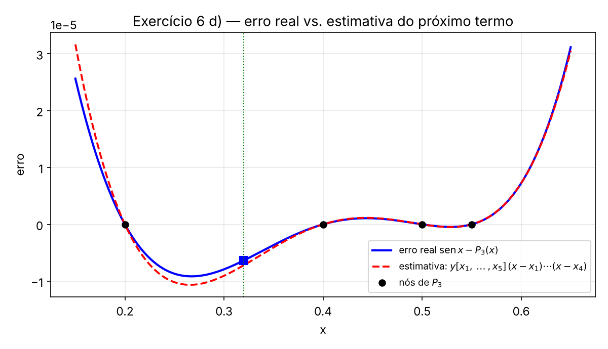
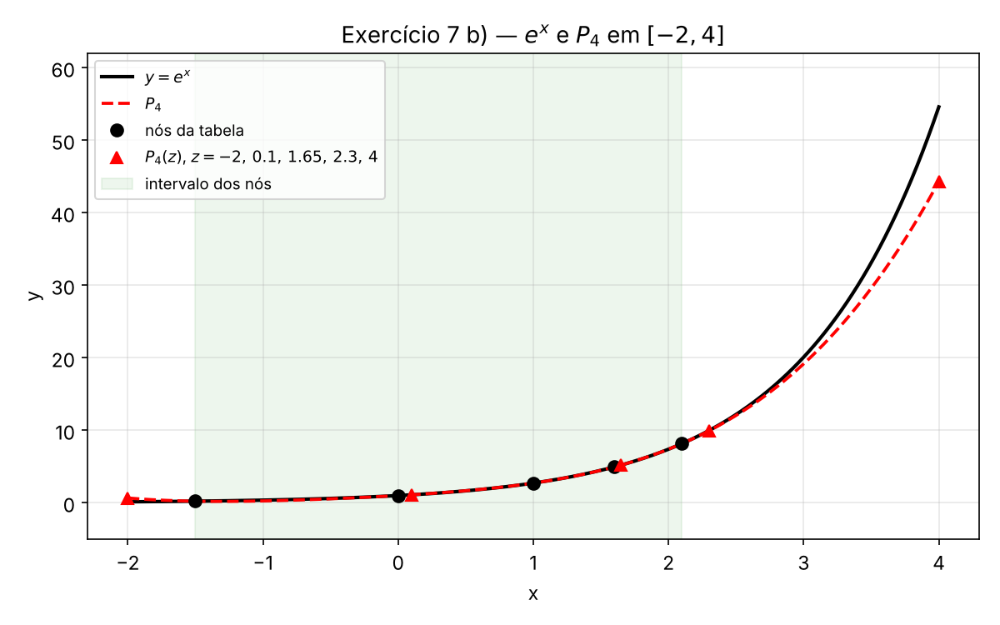

# Interpolação polinomial
## Ficha 2 — exercícios 5, 6, 7 e 9
[[ExerciciosInterpolacao.pdf]] · [[Interpolacao.pdf]]


---

## 0. Resumo teórico (para consulta)

### Diferenças divididas

$$y[x_i]=y_i,\qquad y[x_i,\dots,x_{i+k}]=\frac{y[x_{i+1},\dots,x_{i+k}]-y[x_i,\dots,x_{i+k-1}]}{x_{i+k}-x_i}$$

**Forma de Newton** (usa a 1.ª linha da tabela, onde os nós são $x_1,x_2,\dots$):

$$P_{n-1}(x)=y[x_1]+y[x_1,x_2](x-x_1)+y[x_1,x_2,x_3](x-x_1)(x-x_2)+\cdots$$

### Ligação com derivadas

$$y[x_1,\dots,x_n]=\frac{y^{(n-1)}(\xi)}{(n-1)!},\qquad\xi\in(\min x_i,\max x_i)$$

- Se $y$ é um polinómio de grau $m$: as diferenças divididas de ordem $m$ são **constantes** (= coeficiente principal) e as de ordem $>m$ são **nulas**.

### Erro e estimativa "do próximo termo"

$$E_{n-1}(x)=y(x)-P_{n-1}(x)=y[x_1,\dots,x_n,x]\,(x-x_1)\cdots(x-x_n)\;\approx\;\underbrace{y[x_1,\dots,x_n,x_{n+1}]\,(x-x_1)\cdots(x-x_n)}_{\text{“próximo termo”}}$$

(supondo que as diferenças divididas de ordem $n$ não variam muito).

### Funções da toolbox de AN

```m
function DD = tabDifDiv(x,y)          % tabela de diferenças divididas
n = length(x);  DD = zeros(n);
DD(:,1) = y;                           % coluna 1 = ordenadas
for k = 2:n
    for i = 1:n-k+1
        DD(i,k) = (DD(i+1,k-1) - DD(i,k-1)) / (x(k+i-1) - x(i));
    end
end
```

- **Coluna $k$ de `DD`** = diferenças divididas de ordem $k-1$ (colunas 1, 2, 3, … = ordens 0, 1, 2, …).
- **Só o triângulo superior-esquerdo é preenchido**: na coluna $k$ só as linhas $1,\dots,n-k+1$ têm valores; o resto são **zeros de inicialização** (não são diferenças divididas!).
- `polDifDiv(x,y,z)` devolve $P(z)$ usando a 1.ª linha de `DD` (forma de Newton em esquema de Horner).

---

## 5)

**Enunciado:** $y(x)=x^2$ nos nós $x=0,\,0.2,\,0.25,\,0.5,\,0.7,\,0.75,\,0.8,\,0.9$.

### a) Valores de $y$

$$y=\big(0,\ 0.04,\ 0.0625,\ 0.25,\ 0.49,\ 0.5625,\ 0.64,\ 0.81\big)$$

```m
x = [0 0.2 0.25 0.5 0.7 0.75 0.8 0.9];
y = x.^2
```

### b) Diferenças divididas de 3.ª ordem

$y$ é um polinómio de **grau 2**. Então:

- 1.ª ordem: $y[x_i,x_{i+1}]=\dfrac{x_{i+1}^2-x_i^2}{x_{i+1}-x_i}=x_i+x_{i+1}$
- 2.ª ordem: $y[x_i,x_{i+1},x_{i+2}]=\dfrac{(x_{i+1}+x_{i+2})-(x_i+x_{i+1})}{x_{i+2}-x_i}=1$ (coeficiente principal)
- 3.ª ordem (e superiores): $y[x_i,\dots,x_{i+3}]=\dfrac{y'''(\xi)}{3!}=0$

⟹ **Todas as diferenças divididas de 3.ª ordem são 0** (e também as de ordens 4, 5, 6 e 7).

### c) A matriz $M$ com `tabDifDiv`

```m
M = tabDifDiv(x, y)
```

$$
\begin{array}{|l|l|l|l|l|}
\hline
x_i & y_i & \textbf{ordem 1} & \textbf{ordem 2} & \textbf{ordens 3 a 7} \\ \hline
\text{0} & \text{0} & \text{0.2} & \text{1} & \approx0 \\ \hline
\text{0.2} & \text{0.04} & \text{0.45} & \text{1} & \approx0 \\ \hline
\text{0.25} & \text{0.0625} & \text{0.75} & \text{1} & \approx0 \\ \hline
\text{0.5} & \text{0.25} & \text{1.2} & \text{1} & \approx0 \\ \hline
\text{0.7} & \text{0.49} & \text{1.45} & \text{1} & \approx0 \\ \hline
\text{0.75} & \text{0.5625} & \text{1.55} & \text{1} & \approx0 \\ \hline
\text{0.8} & \text{0.64} & \text{1.7} & \text{—} & \text{—} \\ \hline
\text{0.9} & \text{0.81} & \text{—} & \text{—} & \text{—} \\ \hline
\end{array}
$$

(Coluna 1 de $M$ = $y$; coluna 2 = ordem 1 $=x_i+x_{i+1}$; coluna 3 = ordem 2 $=1$; colunas 4 a 8 = ordens 3 a 7.)

**O que acontece com as colunas 4 a 8:**

- Em teoria são **exatamente 0**: as diferenças divididas de ordem $\ge3$ de um polinómio de grau 2 são nulas.
- Numericamente **não saem exatamente 0**, mas valores minúsculos, de ordem $10^{-13}$–$10^{-12}$ (nos meus cálculos, no máximo $\approx1.3\times10^{-12}$): são **erros de arredondamento**, amplificados pelas divisões por diferenças pequenas entre nós (p.ex. $x_3-x_2=0.05$) e que se vão acumulando de ordem para ordem.
- As entradas "fora do triângulo" (p.ex. $M(8,2{:}8)$) são os zeros da inicialização `zeros(n)`; não são diferenças divididas.

**Conclusão:** o polinómio interpolador $P_7$ (grau $\le7$) destes 8 pontos é o próprio $y=x^2$. Em forma de Newton, só os 3 primeiros termos contam: $P(x)=0+0.2\,(x-0)+1\cdot(x-0)(x-0.2)=x^2$ ✓. Os coeficientes de ordem $\ge3$ (≈ 0) são o "ruído" numérico — e mostram que **valores ≈ 0 na tabela indicam que o grau efetivo do polinómio é menor** (útil para detetar o grau de uma função tabelada).

---

## 6)

**Enunciado:** $y(x)=\operatorname{sen}x$ nos nós $0.2,\ 0.4,\ 0.5,\ 0.55,\ 0.6,\ 0.63,\ 0.67$.

### a) Tabela de valores

```m
x = [0.2 0.4 0.5 0.55 0.6 0.63 0.67];
y = sin(x);
[x' y']
```

$$
\begin{array}{|l|l|l|l|l|l|l|l|}
\hline
x & \textbf{0.2} & \textbf{0.4} & \textbf{0.5} & \textbf{0.55} & \textbf{0.6} & \textbf{0.63} & \textbf{0.67} \\ \hline
\operatorname{sen}x & \text{0.198669} & \text{0.389418} & \text{0.479426} & \text{0.522687} & \text{0.564642} & \text{0.589145} & \text{0.620986} \\ \hline
\end{array}
$$

### b) Tabela de diferenças divididas

```m
DD = tabDifDiv(x, y)
```

$$
\begin{array}{|l|l|l|l|l|l|l|l|}
\hline
x_i & y_i & \textbf{ordem 1} & \textbf{ordem 2} & \textbf{ordem 3} & \textbf{ordem 4} & \textbf{ordem 5} & \textbf{ordem 6} \\ \hline
\text{0.2} & \text{0.198669} & \text{0.953745} & -0.178910 & -0.152412 & \text{0.018094} & \text{0.007380} & -0.000674 \\ \hline
\text{0.4} & \text{0.389418} & \text{0.900072} & -0.232254 & -0.145174 & \text{0.021268} & \text{0.007064} & \text{—} \\ \hline
\text{0.5} & \text{0.479426} & \text{0.865234} & -0.261289 & -0.140282 & \text{0.023175} & \text{—} & \text{—} \\ \hline
\text{0.55} & \text{0.522687} & \text{0.839105} & -0.279526 & -0.136343 & \text{—} & \text{—} & \text{—} \\ \hline
\text{0.6} & \text{0.564642} & \text{0.816743} & -0.295887 & \text{—} & \text{—} & \text{—} & \text{—} \\ \hline
\text{0.63} & \text{0.589145} & \text{0.796031} & \text{—} & \text{—} & \text{—} & \text{—} & \text{—} \\ \hline
\text{0.67} & \text{0.620986} & \text{—} & \text{—} & \text{—} & \text{—} & \text{—} & \text{—} \\ \hline
\end{array}
$$

(Sanidade: $y[x_1,\dots,x_4]=\frac{y'''(\xi)}{3!}=-\frac{\cos\xi}{6}\approx-0.15$ ✓.)

### c) Estimativa de $\operatorname{sen}0.32$ por interpolação cúbica

Cúbica ⟹ **4 nós**. Escolhem-se os 4 mais próximos de $0.32$:

$$|0.32-0.4|=0.08,\quad|0.32-0.2|=0.12,\quad|0.32-0.5|=0.18,\quad|0.32-0.55|=0.23$$

⟹ nós $0.2,\ 0.4,\ 0.5,\ 0.55$ (os 4 primeiros da tabela ⟹ basta a **1.ª linha** de `DD`).

$$P_3(x)=0.198669+0.953745\,(x-0.2)-0.178910\,(x-0.2)(x-0.4)-0.152412\,(x-0.2)(x-0.4)(x-0.5)$$

$$P_3(0.32)=0.198669+0.114449+0.001718-0.000263\approx\boxed{0.314573}$$

```m
z = 0.32;
d = DD(1, 1:4);                                      % diferenças divididas da 1.ª linha
P3 = d(1) + d(2)*(z-x(1)) ...
          + d(3)*(z-x(1))*(z-x(2)) ...
          + d(4)*(z-x(1))*(z-x(2))*(z-x(3))
% equivalente:  polDifDiv(x(1:4), y(1:4), z)
```

```m
P3 = 0.314572909482056          % valor exato: sen(0.32) = 0.314566560616118
```

### d) Estimativa do erro pelo "próximo termo"

O próximo nó da tabela é $x_5=0.6$:

$$E_3(0.32)\approx y[x_1,\dots,x_5]\,(z-x_1)(z-x_2)(z-x_3)(z-x_4)=0.018094\times(0.12)(-0.08)(-0.18)(-0.23)\approx-7.19\times10^{-6}$$

```m
prox      = DD(1,5) * prod(z - x(1:4))     % -7.1913e-06  (estimativa)
erro_real = sin(z) - P3                    % -6.3489e-06  (erro efetivo)
```

$$
\begin{array}{|l|l|}
\hline
 & \textbf{Valor} \\ \hline
\text{Estimativa (próximo termo)} & -7.19\times10^{-6} \\ \hline
\text{Erro efetivo}\ \operatorname{sen}0.32-P_3(0.32) & -6.35\times10^{-6} \\ \hline
\end{array}
$$

**Comentário:** a estimativa tem o **mesmo sinal** e a **mesma ordem de grandeza** que o erro real (só ≈ 13% maior): é uma boa estimativa. O polinómio $P_3$ aproxima $\operatorname{sen}0.32$ com 4 casas decimais corretas (erro $\approx6.3\times10^{-6}\le0.5\times10^{-4}$). A estimativa é razoável porque as diferenças divididas de ordem 4 variam pouco ($0.0181,\ 0.0213,\ 0.0232$) — a hipótese em que se baseia.

```m
% gráfico: erro real vs estimativa do próximo termo
xx = linspace(0.15, 0.65, 600);
w  = @(t,n) prod(t(:) - x(1:n), 2)';            % (t-x1)...(t-xn)
P3x  = d(1) + d(2)*(xx-x(1)) + d(3)*w(xx,2) + d(4)*w(xx,3);
Ereal = sin(xx) - P3x;
Eest  = DD(1,5) * w(xx,4);
plot(xx, Ereal, 'b', xx, Eest, 'r--'); hold on; grid on
plot(x(1:4), 0*x(1:4), 'ko', 'MarkerFaceColor', 'k')
legend('erro real', 'estimativa', 'nós')
```



O gráfico mostra que as duas curvas são quase indistinguíveis (anulam-se nos nós) e que o erro cresce fora do intervalo dos nós.

---

## 7)

**Enunciado:** $e^x$ tabelada com 4 c.d.:

$$
\begin{array}{|l|l|l|l|l|l|}
\hline
x & -1.5 & 0.0 & 1.0 & 1.6 & 2.1 \\ \hline
e^x & \text{0.2231} & \text{1.0000} & \text{2.7183} & \text{4.9530} & \text{8.1662} \\ \hline
\end{array}
$$

$P_4$ = interpolador de grau $\le4$ (5 nós).

### a) Estimativas de $e^z$ com $P_4$

```m
x = [-1.5 0 1 1.6 2.1];
y = [0.2231 1.0000 2.7183 4.9530 8.1662];
z = [-2.0 0.1 1.65 2.3 4.0];
Pz = polDifDiv(x, y, z)
[z' Pz' exp(z)' abs(Pz - exp(z))']
```

Primeira linha de `DD`: $(0.2231,\ 0.5179,\ 0.4801,\ 0.2496,\ 0.0897)$, ou seja

$$P_4(x)=0.2231+0.5179(x+1.5)+0.4801(x+1.5)x+0.2496(x+1.5)x(x-1)+0.0897(x+1.5)x(x-1)(x-1.6)$$

$$
\begin{array}{|l|l|l|l|l|l|}
\hline
z & \textbf{Posição} & P_4(z) & e^z & \textbf{Erro}\ \lvert P_4(z)-e^z\rvert & \lvert\omega(z)\rvert \\ \hline
-2.0 & \text{fora (à esquerda)} & \text{0.6645} & \text{0.1353} & \text{0.529} & \text{44.28} \\ \hline
0.1 & \text{dentro} & \text{1.1121} & \text{1.1052} & \text{0.0069} & \text{0.432} \\ \hline
1.65 & \text{dentro} & \text{5.2085} & \text{5.2070} & \text{0.0015} & \text{0.0760} \\ \hline
2.3 & \text{fora (à direita)} & \text{9.9371} & \text{9.9742} & \text{0.037} & \text{1.591} \\ \hline
4.0 & \text{muito fora} & \text{44.319} & \text{54.598} & \text{10.28} & \text{300.96} \\ \hline
\end{array}
$$

onde $\omega(z)=(z+1.5)\,z\,(z-1)(z-1.6)(z-2.1)$ é o polinómio dos nós da fórmula do erro $E(z)=\dfrac{(e^x)^{(5)}(\xi)}{5!}\,\omega(z)$.

**Comentários:**

- **Interpolação** (dentro de $[-1.5,\,2.1]$: $z=0.1$ e $z=1.65$): erros pequenos ($7\times10^{-3}$ e $1.5\times10^{-3}$), coerentes com $|\omega|$ pequeno.
- **Extrapolação** ($z=-2$, $2.3$, $4$): o erro **cresce muito** à medida que $z$ se afasta dos nós, acompanhando $|\omega(z)|$: $0.037$ a 0.2 do último nó, mas $10.3$ (19%) para $z=4$. Em $z=-2$ o erro **relativo** é de ≈ 390%: $P_4(-2)=0.66$ contra $e^{-2}=0.135$.
- Porquê: $P_4$ é um polinómio de grau 4 com coeficiente principal $0.0897>0$, logo $P_4(x)\to+\infty$ quando $x\to-\infty$, enquanto $e^x\to0$; e para $x$ grande cresce como $x^4$ em vez de exponencialmente. **Extrapolar com polinómios é perigoso.**
- Os valores tabelados têm 4 c.d. (erro de ordem $5\times10^{-5}$), muito menor que os erros acima — o erro dominante é o de interpolação/extrapolação.

### b) Gráfico de $e^x$ e $P_4$ em $[-2,\,4]$

```m
x = [-1.5 0 1 1.6 2.1];
y = [0.2231 1.0000 2.7183 4.9530 8.1662];
p4 = polyfit(x, y, 4);                     % coeficientes de P4 (ver exercício 9)
zz = linspace(-2, 4, 600);
figure; hold on; grid on
plot(zz, exp(zz), 'k', 'LineWidth', 2)
plot(zz, polyval(p4, zz), 'r--', 'LineWidth', 1.5)
plot(x, y, 'ko', 'MarkerFaceColor', 'k')
legend('e^x', 'P_4', 'nós', 'Location', 'northwest')
ylim([-5 62]); xlabel('x'); ylabel('y')
```



Dentro de $[-1.5,2.1]$ as duas curvas são praticamente indistinguíveis; à esquerda $P_4$ "levanta" (em vez de tender para 0) e à direita fica abaixo de $e^x$ (a diferença chega a ≈ 10 em $x=4$).

---

## 9)

**Enunciado:** obter ajuda sobre `polyfit` e `polyval`; usar `polyfit` para construir o polinómio interpolador; usar nas resoluções anteriores.

### Resumo da ajuda (`help polyfit`, `help polyval`)

```m
p = polyfit(x, y, n)      % polinómio de grau n que melhor aproxima (x,y) em mínimos quadrados
z = polyval(p, xx)        % avalia o polinómio p nos pontos xx
```

- $p=[p_1,\dots,p_{n+1}]$ são os coeficientes por **potências decrescentes**: $\;p(x)=p_1x^n+p_2x^{n-1}+\dots+p_nx+p_{n+1}$.
- **Para obter o polinómio INTERPOLADOR:** usar $n=\texttt{length(x)}-1$ ($m$ pontos ⟹ grau $m-1$); o sistema de Vandermonde fica determinado e a "melhor aproximação" é **exata** nos nós (erro nulo).
- ⚠️ Com $n<\texttt{length(x)}-1$ o `polyfit` **não interpola**: faz um ajuste de mínimos quadrados (a curva não passa pelos pontos).
- `polyval(p, xx)` aceita vetores; `[p,S,mu] = polyfit(x,y,n)` permite centrar/escalar $x$ (útil para grau elevado); para grau alto o Matlab pode avisar *"Polynomial is badly conditioned"*.

### Aplicação a exercícios anteriores

**Ex. 5** (interpolar $y=x^2$ em 8 pontos):

```m
x = [0 0.2 0.25 0.5 0.7 0.75 0.8 0.9];
p = polyfit(x, x.^2, 7)          % grau 7 = length(x) - 1
```

Resultado: $p\approx[0\ 0\ 0\ 0\ 0\ 1\ 0\ 0]$ — só o coeficiente de $x^2$ é 1; os restantes são ≈ 0 (ruído numérico de ordem $\sim10^{-13}$). Confirma o exercício 5: o interpolador é $x^2$.

**Ex. 6 c)** (cúbica para $\operatorname{sen}0.32$):

```m
x = [0.2 0.4 0.5 0.55 0.6 0.63 0.67];  y = sin(x);
p3 = polyfit(x(1:4), y(1:4), 3);
polyval(p3, 0.32)                 % 0.314572909482056  (= polDifDiv(x(1:4),y(1:4),0.32))
```

**Ex. 7** ($P_4$ de $e^x$):

```m
p4 = polyfit([-1.5 0 1 1.6 2.1], [0.2231 1.0000 2.7183 4.9530 8.1662], 4)
polyval(p4, [-2.0 0.1 1.65 2.3 4.0])
```

$$p_4=[0.0897\ \ 0.1509\ \ 0.3986\ \ 1.0791\ \ 1.0000]\ \Rightarrow\ P_4(x)\approx0.0897x^4+0.1509x^3+0.3986x^2+1.0791x+1.0000$$

(compara com a série de Taylor de $e^x$: $\frac1{24}=0.0417,\ \frac16=0.1667,\ \frac12,\ 1,\ 1$). Os valores de `polyval` coincidem com os de `polDifDiv`: $0.6645,\ 1.1121,\ 5.2085,\ 9.9371,\ 44.319$.

**Ex. 1** (já feito): `p1 = polyfit([0 0.4], sin([0 0.4]), 1)`, `p2 = polyfit([0 0.4 0.6], sin([0 0.4 0.6]), 2)`.

### `polyfit` vs diferenças divididas

$$
\begin{array}{|l|l|l|}
\hline
 & \texttt{polyfit}\ \textbf{+}\ \texttt{polyval} & \texttt{tabDifDiv}\ \textbf{+}\ \texttt{polDifDiv} \\ \hline
\text{Resultado} & \begin{array}{l} \text{coeficientes na base canónica} \\ 1,x,x^2,\dots \end{array} & \text{coeficientes na base de Newton} \\ \hline
\text{Método} & \text{resolve o sistema de Vandermonde} & \begin{array}{l} \text{recorrência com diferenças} \\ \text{divididas} \end{array} \\ \hline
\text{Estabilidade} & \text{mal condicionado para}\ n\ \text{grande} & \text{mais estável} \\ \hline
\text{Acrescentar um nó} & \text{recalcular tudo} & \text{acrescenta-se um termo} \\ \hline
\text{Estimativa do erro} & \text{não fornece} & \text{\textquotedblleft{}próximo termo\textquotedblright{} (ex. 6 d)} \\ \hline
\text{Vantagem} & \begin{array}{l} \text{muito simples; coeficientes} \\ \text{explícitos} \end{array} & \begin{array}{l} \text{tabela mostra o grau efetivo (ex.} \\ \text{5)} \end{array} \\ \hline
\end{array}
$$

O polinómio interpolador é **único** (grau $\le n$ nos $n+1$ nós): os dois métodos dão o mesmo polinómio, diferindo apenas em arredondamentos (≈ $10^{-16}$ nos exemplos acima).

