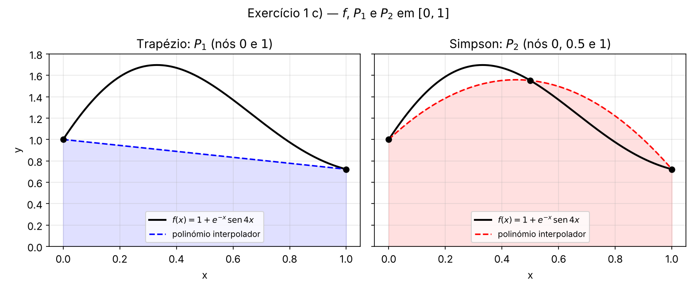
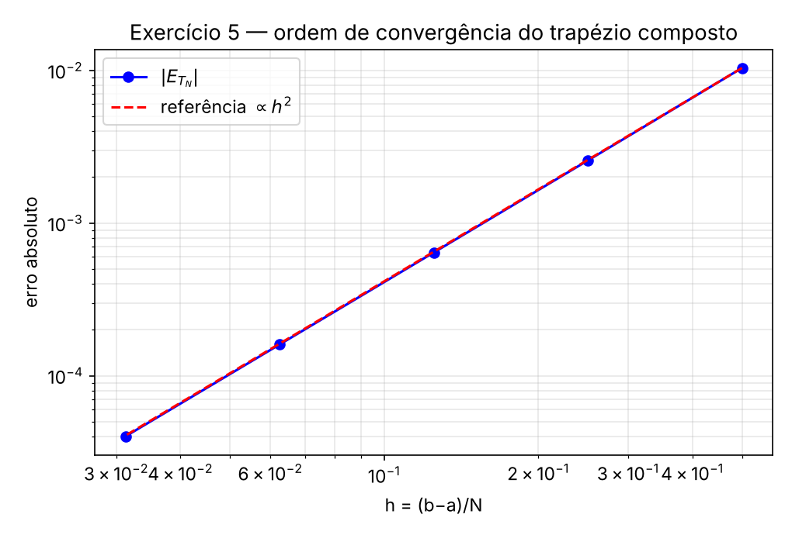

# Quadratura numérica
## Ficha 3
[[ExerciciosQuadratura.pdf]] · [[QuadraturaALUNOS.pdf]]
Exercícios resolvidos: **1; 2; 3; 4; 5**

---

## 0. Resumo teórico (para consulta)

### 0.1 O problema

Estimar $I[f]=\displaystyle\int_a^b f(x)\,dx$ por uma **regra de quadratura**

$$Q_n[f]=\sum_{i=1}^{n}w_i\,f(x_i),\qquad I[f]=Q_n[f]+E_n[f]$$

- $x_i$ → **abcissas** (pontos de quadratura); $w_i$ → **pesos**; $\sum w_i=b-a$.
- Recorre-se à quadratura numérica quando a primitiva não é elementar (ex.: $e^{-x^2}$), é demasiado complicada, ou só se conhecem valores tabelados de $f$.

### 0.2 Regras de Newton-Cotes (fechadas)

$Q_n$ usa $n$ abcissas igualmente espaçadas, $x_i=a+(i-1)h$, $h=\dfrac{b-a}{n-1}$, e pesos

$$w_i=\int_a^bL_i(x)\,dx$$

(integra-se o polinómio interpolador $P_{n-1}$ de $f$ nessas abcissas).

- **Grau de exatidão** $m$: a regra é exata para polinómios de grau $\le m$ e falha para algum de grau $m+1$.
- $Q_n$ tem grau de exatidão $\ge n-1$; para $n$ **ímpar** é $n$ (um grau a mais do que seria de esperar).

### 0.3 Regras simples

$$
\begin{array}{|l|l|l|l|l|}
\hline
\textbf{Regra} & n & \textbf{Fórmula} & \textbf{Erro} & \textbf{Grau de exatidão} \\ \hline
\textbf{Trapézio} & \text{2} & \dfrac h2\,[f(x_1)+f(x_2)]\text{,}\ \;h=b-a & -\dfrac{h^3}{12}f''(\eta) & \text{1} \\ \hline
\textbf{Simpson} & \text{3} & \begin{array}{l} \dfrac h3\,[f(x_1)+4f(x_2)+f(x_3)]\text{,} \\ \;h=\dfrac{b-a}2 \end{array} & -\dfrac{h^5}{90}f^{(4)}(\eta) & \text{3} \\ \hline
\text{Simpson 3/8} & \text{4} & \dfrac{3h}8\,[f_1+3f_2+3f_3+f_4] & \text{(ver tabela dos slides)} & \text{3} \\ \hline
\end{array}
$$

(com $\eta\in(a,b)$.) Para $n\ge9$ há pesos grandes e de sinais diferentes → cancelamento subtrativo → raramente usadas.

### 0.4 Regras compostas

Dividir $[a,b]$ em $N$ subintervalos de comprimento $h=\dfrac{b-a}N$, $x_i=a+(i-1)h$, $i=1,\dots,N+1$, e aplicar a regra simples em cada um.

**Trapézio composta** ($T_N$):

$$T_N=\frac h2\big[f_1+2(f_2+\dots+f_N)+f_{N+1}\big],\qquad E_{T_N}=-\frac{(b-a)h^2}{12}\,f''(\eta)$$

**Simpson composta** ($S_N$, com $N=2m$ **par**):

$$S_N=\frac h3\big[f_1+4(f_2+f_4+\dots+f_{2m})+2(f_3+f_5+\dots+f_{2m-1})+f_{2m+1}\big],\qquad E_{S_N}=-\frac{(b-a)h^4}{180}\,f^{(4)}(\eta)$$

**Ordem de convergência:** trapézio $O(h^2)$; Simpson $O(h^4)$.
**Majorante:** $|E_{T_N}|\le\dfrac{(b-a)h^2}{12}\,M_2$, $\;M_2=\max_{[a,b]}|f''|$; $\;|E_{S_N}|\le\dfrac{(b-a)h^4}{180}\,M_4$.

### 0.5 Estimativas do erro (sem derivadas)

Se $f''$ (resp. $f^{(4)}$) não variar muito em $[a,b]$:

$$|E_{T_N}|\approx\left|\frac{T_N-T_{N/2}}{3}\right|\;(N\text{ par}),\qquad|E_{S_N}|\approx\left|\frac{S_N-S_{N/2}}{15}\right|\;(N\text{ múltiplo de }4)$$

*(Origem: $E_{T_{N/2}}\approx4E_{T_N}$ ⟹ $3E_{T_N}\approx T_N-T_{N/2}$; no Simpson o fator é $2^4=16$ ⟹ $15E_{S_N}\approx S_N-S_{N/2}$.)*

### 0.6 Funções Matlab da toolbox de AN

$$
\begin{array}{|l|l|}
\hline
\textbf{Função} & \textbf{O que faz} \\ \hline
\texttt{regTrapezio(f,a,b,N)} & \begin{array}{l} \text{trapézio composta e, se}\ N\ \text{par,} \\ \text{estimativa do erro} \end{array} \\ \hline
\texttt{regSimpson(f,a,b,N)} & \begin{array}{l} \text{Simpson composta e, se}\ N\ \text{múltiplo} \\ \text{de 4, estimativa do erro} \end{array} \\ \hline
\texttt{integral(f,a,b)} & \begin{array}{l} \text{integração numérica pré-definida} \\ \text{do Matlab} \end{array} \\ \hline
\end{array}
$$

---

## 1)

**Enunciado:** $I=\displaystyle\int_0^1\big(1+e^{-x}\operatorname{sen}4x\big)\,dx$.

### a) Aproximações para $I$

$f(x)=1+e^{-x}\operatorname{sen}4x$. Valores necessários:

$$f(0)=1,\qquad f(0.5)=1+e^{-0.5}\operatorname{sen}2\approx1.5515,\qquad f(1)=1+e^{-1}\operatorname{sen}4\approx0.7216$$

**(i) Regra do trapézio** ($h=b-a=1$):

$$T=\frac{h}{2}\,[f(0)+f(1)]=\frac12\,(1+0.7216)\approx\boxed{0.8608}$$

**(ii) Regra de Simpson** ($h=\frac{b-a}2=0.5$):

$$S=\frac h3\,[f(0)+4f(0.5)+f(1)]=\frac{0.5}{3}\,(1+4\times1.5515+0.7216)\approx\boxed{1.3213}$$

```m
f = @(x) 1 + exp(-x).*sin(4*x);

% (i) regra do trapézio: h = b - a = 1
h = 1;
Q2 = (h/2)*(f(0) + f(1))              % 0.8608

% (ii) regra de Simpson: h = (b-a)/2 = 0.5
h = 0.5;
Q3 = (h/3)*(f(0) + 4*f(0.5) + f(1))   % 1.3213
```

```m
Q2 = 0.8608
Q3 = 1.3213
```

> ⚠️ **Correção ao `TP7_AN.m`:** na linha de Simpson faltava o peso **4** no ponto central (`f(0)+f(0.5)+f(1)`), o que dava `Q3 = 0.5455`. Com os pesos corretos, $Q_3=1.3213$.

### b) Erro de cada aproximação

Com $I=1.3082506046$ (10 c.d.):

```m
IntE = 1.3082506046;
errT = abs(IntE - Q2)     % 0.4475
errS = abs(IntE - Q3)     % 0.0130
```

> ⚠️ No `TP7_AN.m` o valor estava escrito como `1.8250506046`; o valor do enunciado é **1.3082506046**.

$$
\begin{array}{|l|l|l|}
\hline
\textbf{Regra} & \textbf{Aproximação} & \textbf{Erro}\ \lvert I-Q\rvert \\ \hline
\text{Trapézio} & 0.8608 & 0.4475 \\ \hline
\text{Simpson} & 1.3213 & 0.0130 \\ \hline
\end{array}
$$

**Comentário:** o erro do trapézio é enorme (≈ 34% de $I$); o de Simpson é cerca de **34 vezes menor**. Ambos usam poucos pontos, mas Simpson é muito mais precisa.

### c) Gráficos de $f$, $P_1$ e $P_2$

$P_1$ interpola $f$ em $x=0,1$; $P_2$ interpola $f$ em $x=0,\frac12,1$. Lembra que **$Q_2[f]=\int_0^1P_1$** e **$Q_3[f]=\int_0^1P_2$** (a regra integra o polinómio interpolador).

```m
f  = @(x) 1 + exp(-x).*sin(4*x);
p1 = polyfit([0 1],     f([0 1]),     1);   % interpolador de grau 1
p2 = polyfit([0 0.5 1], f([0 0.5 1]), 2);   % interpolador de grau 2

figure; hold on; grid on
fplot(f, [0 1], 'k', 'LineWidth', 2)
fplot(@(t) polyval(p1,t), [0 1], 'b--', 'LineWidth', 1.5)
fplot(@(t) polyval(p2,t), [0 1], 'r-.', 'LineWidth', 1.5)
plot([0 0.5 1], f([0 0.5 1]), 'ko', 'MarkerFaceColor', 'k')
legend('f', 'P_1', 'P_2', 'nós', 'Location', 'south')
xlabel('x'); ylabel('y')

% verificação: integrar os polinómios dá exatamente Q2 e Q3
polyval(polyint(p1), 1)    % 0.8608
polyval(polyint(p2), 1)    % 1.3213
```



**Justificação dos resultados:**

- $f$ tem uma "lomba" pronunciada (máximo ≈ 1.7 perto de $x=0.33$) e depois desce. A **reta** $P_1$ (de $(0,1)$ a $(1,0.72)$) fica muito abaixo de $f$ em quase todo o intervalo → a área do trapézio **subestima muito** $I$ ($0.8608$ vs $1.3083$).
- A **parábola** $P_2$ acompanha a forma da lomba (passa pelo ponto central $f(0.5)$) → o erro é bem menor ($0.0130$).
- Em termos de erro: o do trapézio depende de $f''$ ($-\frac{h^3}{12}f''$), grande aqui por causa da curvatura de $f$; o de Simpson depende de $f^{(4)}$ com $h^5/90$, muito menor para o mesmo $h$.

---

## 2)

**Enunciado:** $I=\displaystyle\int_0^{0.5}(4x^3+2x+1)\,dx$.

### a) Estimativas

$g(x)=4x^3+2x+1$: $\;g(0)=1,\quad g(0.25)=1.5625,\quad g(0.5)=2.5$.

**(i) Trapézio** ($h=0.5$):

$$T=\frac{0.5}2\,(1+2.5)=0.25\times3.5=\boxed{0.875}$$

**(ii) Simpson** ($h=0.25$):

$$S=\frac{0.25}3\,(1+4\times1.5625+2.5)=\frac{0.25}{3}\times9.75=\boxed{0.8125}$$

```m
g = @(x) 4*x.^3 + 2*x + 1;
T = (0.5/2)*(g(0) + g(0.5))                    % 0.8750
S = (0.25/3)*(g(0) + 4*g(0.25) + g(0.5))       % 0.8125
```

### b) Valor exato e erros

$$I=\Big[x^4+x^2+x\Big]_0^{0.5}=0.0625+0.25+0.5=\boxed{0.8125}$$

$$
\begin{array}{|l|l|l|}
\hline
\textbf{Regra} & \textbf{Valor} & \textbf{Erro}\ I-Q \\ \hline
\text{Trapézio} & 0.875 & -0.0625 \\ \hline
\text{Simpson} & 0.8125 & 0 \\ \hline
\end{array}
$$

**Comentário:**

- **Simpson é exata**: o integrando é um polinómio de grau $3$ e a regra de Simpson tem grau de exatidão $3$ (de facto $E=-\frac{h^5}{90}f^{(4)}(\eta)=0$, porque $g^{(4)}\equiv0$).
- O trapézio só é exato até grau $1$. Verifica-se a fórmula do erro: $E=-\dfrac{h^3}{12}g''(\eta)=-\dfrac{0.125}{12}\cdot24\eta=-0.25\,\eta$; igualando a $-0.0625$ obtém-se $\eta=0.25\in(0,0.5)$ ✓ (o ponto médio, porque $g''$ é linear).
- Nota: isto confirma a observação dos slides de que as regras com $n$ ímpar têm grau de exatidão $n$ (Simpson: $n=3$, grau 3).

---

## 3)

**Enunciado:** determinar $N$ para garantir, com o trapézio composto, 6 casas decimais de precisão em $I=\displaystyle\int_2^7\frac1x\,dx$ (ignorando erros de arredondamento).

"6 casas decimais" ⟺ $|E_{T_N}|\le0.5\times10^{-6}$.

**Majorante do erro:** $f(x)=\dfrac1x$, $\;f''(x)=\dfrac2{x^3}$, positiva e **decrescente** em $[2,7]$, logo

$$M_2=\max_{[2,7]}|f''|=f''(2)=\frac28=\frac14$$

Com $b-a=5$ e $h=\dfrac5N$:

$$|E_{T_N}|\le\frac{(b-a)h^2}{12}M_2=\frac{5}{12}\cdot\frac{25}{N^2}\cdot\frac14=\frac{125}{48\,N^2}$$

**Condição:**

$$\frac{125}{48\,N^2}\le0.5\times10^{-6}\;\Longleftrightarrow\;N^2\ge\frac{125}{48\times0.5\times10^{-6}}\approx5.2083\times10^{6}\;\Longleftrightarrow\;N\ge2282.18$$

$$\boxed{N=2283}$$

```m
N = ceil(sqrt(125/(48*0.5e-6)))     % 2283
% verificação do majorante:
125/(48*2283^2)                     % 4.9964e-07  (<= 0.5e-6)  ✓
125/(48*2282^2)                     % 5.0008e-07  (>  0.5e-6)  ✗
```

Com $N=2282$ o majorante já excede $0.5\times10^{-6}$; com $N=2283$ cumpre.

---

## 4)

### a) Análise da função `regTrapezio`

```m
function [int_Aprox, est_erro] = regTrapezio(f, a, b, N)
h = (b-a)/N;                                              % passo
abcissas = a:h:b;                                         % N+1 nós
y = f(abcissas);                                          % valores de f nos nós
int_Aprox  = (h/2)*(y(1) + 2*sum(y(2:end-1)) + y(end));   % T_N
int_Aprox2 = h*(y(1) + 2*sum(y(3:2:end-2)) + y(end));     % T_{N/2}
est_erro = abs(int_Aprox - int_Aprox2)/3;                 % |T_N - T_{N/2}|/3
```

- **`int_Aprox`** é a fórmula $T_N=\frac h2[f_1+2(f_2+\dots+f_N)+f_{N+1}]$: `y(2:end-1)` são os nós interiores.
- **`int_Aprox2`** é $T_{N/2}$, o trapézio com passo $2h$ (metade dos subintervalos): usa só os nós de **índice ímpar** (`y(3:2:end-2)` são os interiores $x_3,x_5,\dots,x_{N-1}$) e o fator é $\frac{2h}2=h$. Requer **$N$ par**.
- **`est_erro`** aplica a estimativa $|E_{T_N}|\approx\frac{|T_N-T_{N/2}|}3$.
- A função precisa de $f$ **vetorizada** (`.*`, `./`, `.^`), porque é avaliada num vetor de abcissas.

### b) $I=\displaystyle\int_1^2\cos\!\left(\frac x5\right)dx$ com trapézio composto, $N=10$

```m
f = @(x) cos(x/5);
[int_Aprox, est_erro] = regTrapezio(f, 1, 2, 10)
```

```m
int_Aprox = 0.9537        % 0.9537132659
est_erro  = 3.1793e-05
```

### c) Erro efetivo e comparação

Valor exato: $I=5\Big[\operatorname{sen}\frac x5\Big]_1^2=5\,(\operatorname{sen}0.4-\operatorname{sen}0.2)=0.9537450576$.

```m
int_exato = 5*(sin(0.4) - sin(0.2));
erro = abs(int_Aprox - int_exato)     % 3.1792e-05
```

$$
\begin{array}{|l|l|}
\hline
 & \textbf{Valor} \\ \hline
\text{Estimativa do erro} & 3.1793\times10^{-5} \\ \hline
\text{Erro efetivo} & 3.1792\times10^{-5} \\ \hline
\end{array}
$$

A estimativa é **praticamente igual** ao erro real. Isto acontece porque $f''(x)=-\frac1{25}\cos\frac x5$ varia muito pouco em $[1,2]$ (de ≈ $-0.0392$ em $x=1$ a ≈ $-0.0368$ em $x=2$), que é exatamente a hipótese em que a estimativa se baseia.

### d) Função `regSimpson`, $N=8$ e $N=10$

```m
function [int_Aprox, est_erro] = regSimpson(f, a, b, N)
h = (b-a)/N;
abcissas = a:h:b;
y = f(abcissas);
yPar   = y(2:2:end-1);          % nós de índice par   (peso 4)
yImpar = y(3:2:end-2);          % nós de índice ímpar interiores (peso 2)
int_Aprox = (h/3)*(y(1) + 4*sum(yPar) + 2*sum(yImpar) + y(end));   % S_N

est_erro = [];
if mod(N,4) == 0                % estimativa só se N múltiplo de 4
    y2 = y(1:2:end);            % nós de S_{N/2} (passo 2h)
    int_Aprox2 = (2*h/3)*(y2(1) + 4*sum(y2(2:2:end-1)) + 2*sum(y2(3:2:end-2)) + y2(end));
    est_erro = abs(int_Aprox - int_Aprox2)/15;
else
    disp('Para estimar o erro, N tem de ser múltiplo de 4')
end
```

```m
format long
[S8,  e8 ] = regSimpson(f, 1, 2, 8)
[S10, e10] = regSimpson(f, 1, 2, 10)
abs(int_exato - S8)
abs(int_exato - S10)
```

$$
\begin{array}{|l|l|l|l|}
\hline
N & S_N & \textbf{Estimativa do erro} & \textbf{Erro efetivo} \\ \hline
\text{8} & 0.9537450596 & 2.070\times10^{-9} & 2.070\times10^{-9} \\ \hline
\text{10} & 0.9537450584 & \text{— (}N\ \text{não é múltiplo de 4)} & 8.48\times10^{-10} \\ \hline
\end{array}
$$

**Comentários:**

- Com $N=8$ a estimativa $\frac{|S_8-S_4|}{15}$ coincide com o erro real.
- Com $N=10$ não é possível estimar o erro com esta função (precisaria de $S_5$, e $5$ é ímpar), mas o erro real é menor porque $h$ é menor: como $E\propto h^4$, $\;(8/10)^4\approx0.41$ e $2.07\times10^{-9}\times0.41\approx8.5\times10^{-10}$ ✓.
- Comparação com o trapézio: $T_{10}$ tinha erro $3.2\times10^{-5}$; $S_8$ já tem erro de ordem $10^{-9}$ — **quatro ordens de grandeza** melhor, com um custo semelhante (9 avaliações de $f$ contra 11).

---

## 5)

**Enunciado:** $I=\displaystyle\int_1^6\Big(2+\operatorname{sen}(2\sqrt x)\Big)dx$, com $I=8.1834792077$.

### a) Aproximações $T_N$

```m
f = @(x) 2 + sin(2*sqrt(x));
N = [10 20 40 80 160];
TN = zeros(size(N));
for k = 1:length(N)
    TN(k) = regTrapezio(f, 1, 6, N(k));
end
format long
TN'
```

### b) Erros e ordem de aproximação

```m
Iex  = 8.1834792077;
erro = abs(Iex - TN)
razao = erro(1:end-1) ./ erro(2:end)
```

$$
\begin{array}{|l|l|l|l|l|}
\hline
N & h=\dfrac5N & T_N & \lvert E_{T_N}\rvert & \textbf{Razão}\ \dfrac{\lvert E_{T_{N/2}}\rvert}{\lvert E_{T_N}\rvert} \\ \hline
\text{10} & \text{0.5} & 8.1938545652 & 1.0375\times10^{-2} & \text{—} \\ \hline
\text{20} & \text{0.25} & 8.1860492638 & 2.5701\times10^{-3} & \text{4.037} \\ \hline
\text{40} & \text{0.125} & 8.1841201918 & 6.4098\times10^{-4} & \text{4.010} \\ \hline
\text{80} & \text{0.0625} & 8.1836393573 & 1.6015\times10^{-4} & \text{4.002} \\ \hline
\text{160} & \text{0.03125} & 8.1835192390 & 4.0031\times10^{-5} & \text{4.001} \\ \hline
\end{array}
$$

**Conclusão:** se $|E_{T_N}|\approx C\,h^2$, ao **dobrar $N$** ($h\to h/2$) o erro divide-se por $2^2=4$. As razões obtidas tendem para $4$ ($4.04,\ 4.01,\ 4.002,\ 4.001$) → os resultados **confirmam a ordem $O(h^2)$** da regra do trapézio composta.

Em gráfico log-log, os pontos $(h,|E|)$ ficam sobre uma reta de **declive 2**:

```m
h = 5 ./ N;
loglog(h, erro, 'bo-'); hold on; grid on
loglog(h, erro(1)*(h/h(1)).^2, 'r--')       % referência ∝ h^2
xlabel('h'); ylabel('|E_{T_N}|')
legend('erro efetivo', 'h^2 (referência)', 'Location', 'northwest')
```



