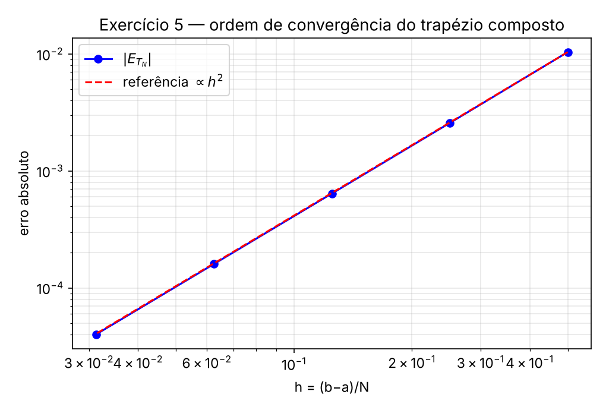
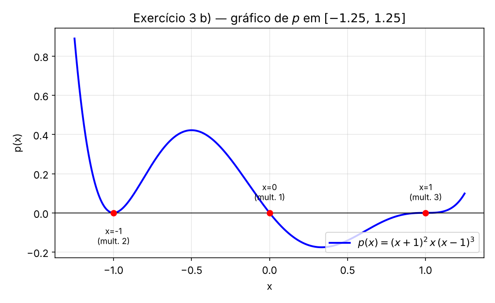
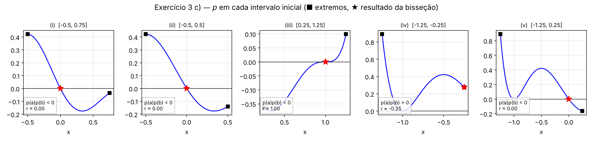

# Análise Numérica — Apontamentos
**Quadratura numérica** (Ficha 3: ex. 3; 5; 6) e **Equações não lineares** (ex. 1; 2; 3)

[[ExerciciosQuadratura.pdf]] · [[QuadraturaALUNOS.pdf]] · [[ExerciciosEquacoesNaoLineares.pdf]] · [[EquacoesNaoLineares.pdf]]

---

# PARTE A — Quadratura numérica (Ficha 3)

**Fórmulas usadas nesta parte** (resumo completo na secção 0 das notas `Ficha3_Quadratura_apontamentos.md`):

$$T_N=\frac h2\big[f_1+2(f_2+\dots+f_N)+f_{N+1}\big],\quad E_{T_N}=-\frac{(b-a)h^2}{12}f''(\eta),\quad h=\frac{b-a}N$$

$$E_{S_N}=-\frac{(b-a)h^4}{180}f^{(4)}(\eta),\qquad|E_{T_N}|\approx\frac{|T_N-T_{N/2}|}3,\qquad|E_{S_N}|\approx\frac{|S_N-S_{N/2}|}{15}\ (4\mid N)$$

## 3)

**Enunciado:** $N$ para garantir 6 c.d. com o trapézio composto em $I=\displaystyle\int_2^7\frac1x\,dx$ (sem erros de arredondamento).

"6 casas decimais" ⟺ $|E_{T_N}|\le0.5\times10^{-6}$.

$f(x)=\frac1x$, $\;f''(x)=\frac2{x^3}$, decrescente em $[2,7]$ ⟹ $M_2=f''(2)=\frac14$. Com $b-a=5$ e $h=\frac5N$:

$$|E_{T_N}|\le\frac{(b-a)h^2}{12}M_2=\frac5{12}\cdot\frac{25}{N^2}\cdot\frac14=\frac{125}{48N^2}\le0.5\times10^{-6}\;\Longleftrightarrow\;N\ge\sqrt{\frac{125}{48\times0.5\times10^{-6}}}\approx2282.18$$

$$\boxed{N=2283}$$

```m
N = ceil(sqrt(125/(48*0.5e-6)))     % 2283
125/(48*2283^2)                     % 4.9964e-07  (<= 0.5e-6)  ✓
125/(48*2282^2)                     % 5.0008e-07  (>  0.5e-6)  ✗
```

## 5)

**Enunciado:** $I=\displaystyle\int_1^6\big(2+\operatorname{sen}(2\sqrt x)\big)dx$, $\;I=8.1834792077$; $T_N$ para $N=10,20,40,80,160$; confirmar $O(h^2)$.

```m
f = @(x) 2 + sin(2*sqrt(x));
N = [10 20 40 80 160];
TN = zeros(size(N));
for k = 1:length(N)
    TN(k) = regTrapezio(f, 1, 6, N(k));
end
format long
Iex   = 8.1834792077;
erro  = abs(Iex - TN)
razao = erro(1:end-1) ./ erro(2:end)
```

$$
\begin{array}{|l|l|l|l|l|}
\hline
N & h=\dfrac5N & T_N & \lvert E_{T_N}\rvert & \textbf{Razão}\ \dfrac{\lvert E_{T_{N/2}}\rvert}{\lvert E_{T_N}\rvert} \\ \hline
\text{10} & \text{0.5} & 8.1938545652 & 1.0375\times10^{-2} & \text{—} \\ \hline
\text{20} & \text{0.25} & 8.1860492638 & 2.5701\times10^{-3} & \text{4.037} \\ \hline
\text{40} & \text{0.125} & 8.1841201918 & 6.4098\times10^{-4} & \text{4.010} \\ \hline
\text{80} & \text{0.0625} & 8.1836393573 & 1.6015\times10^{-4} & \text{4.002} \\ \hline
\text{160} & \text{0.03125} & 8.1835192390 & 4.0031\times10^{-5} & \text{4.001} \\ \hline
\end{array}
$$

**Conclusão:** se $|E_{T_N}|\approx Ch^2$, ao duplicar $N$ ($h\to h/2$) o erro divide-se por $2^2=4$. As razões tendem para $4$ ⟹ os resultados **confirmam a ordem $O(h^2)$**.

```m
h = 5 ./ N;
loglog(h, erro, 'bo-'); hold on; grid on
loglog(h, erro(1)*(h/h(1)).^2, 'r--')      % referência ∝ h^2
xlabel('h'); ylabel('|E_{T_N}|'); legend('erro efetivo','h^2','Location','northwest')
```



## 6)

### a) Análise da função `regSimpson`

```m
function [int_Aprox, est_erro] = regSimpson(f, a, b, N)
h = (b-a)/N;                         % passo
abcissas = a:h:b;                    % N+1 nós
y = f(abcissas);
yPar   = y(2:2:end-1);               % nós de índice par   (peso 4)
yImpar = y(3:2:end-2);               % nós interiores de índice ímpar (peso 2)
int_Aprox = (h/3)*(y(1) + 4*sum(yPar) + 2*sum(yImpar) + y(end));   % S_N
% (versão da toolbox: se N é múltiplo de 4, calcula também S_{N/2} (passo 2h)
%  e est_erro = |S_N - S_{N/2}|/15)
```

- Implementa $S_N=\frac h3[f_1+4(f_2+f_4+\dots)+2(f_3+f_5+\dots)+f_{N+1}]$, com $N$ **par**.
- A estimativa do erro só é calculada se **$N$ for múltiplo de 4** (para que $N/2$ continue par e $S_{N/2}$ exista).

### b) $I=\displaystyle\int_{-0.1}^{0.1}\cos x\,dx$ com Simpson composta, $N=8$

$h=\dfrac{0.2}{8}=0.025$.

```m
f = @(x) cos(x);
[S8, est_erro] = regSimpson(f, -0.1, 0.1, 8)
int_exato = 2*sin(0.1);
erro = abs(int_exato - S8)
```

```m
S8       = 0.199666833727
est_erro = 4.3344e-10
erro     = 4.3334e-10          % int_exato = 2 sen(0.1) = 0.199666833294
```

$$
\begin{array}{|l|l|}
\hline
 & \textbf{Valor} \\ \hline
\text{Estimativa do erro}\ \dfrac{\lvert S_8-S_4\rvert}{15} & 4.3344\times10^{-10} \\ \hline
\text{Erro efetivo} & 4.3334\times10^{-10} \\ \hline
\text{Majorante teórico}\ \dfrac{(b-a)h^4}{180}\max\lvert\cos\rvert & \dfrac{0.2\,(0.025)^4}{180}\approx4.34\times10^{-10} \\ \hline
\end{array}
$$

**Comentário:** a estimativa coincide praticamente com o erro real (diferem apenas no 4.º algarismo significativo). Isto acontece porque $f^{(4)}(x)=\cos x\approx1$ é quase constante em $[-0.1,0.1]$ — a hipótese em que a estimativa se apoia. O integral calcula-se com cerca de 9 casas decimais corretas com apenas $N=8$.

---

# PARTE B — Equações não lineares: Método da Bisseção

## 0. Resumo teórico

**Problema:** dada $f$ real, encontrar $r$ com $f(r)=0$ (raiz ou zero de $f$).

**Convergência e ordem:** com $e_k=r-x_k$, o método tem ordem $p$ se $\displaystyle\lim\frac{|e_{k+1}|}{|e_k|^p}=C$; $p=1$ ⟹ linear, $p=2$ ⟹ quadrática. Se apenas $|e_k|\le Ac^k$ ($0<c<1$), a convergência é linear com razão $c$.

### Método da bisseção

Baseia-se no **Teorema do Valor Intermédio**: se $f\in C[a,b]$ e $f(a)f(b)<0$, existe pelo menos uma raiz em $(a,b)$.

Em cada passo: $m=\dfrac{a+b}2$;
- $f(m)=0$ ⟹ $m$ é raiz;
- $f(a)f(m)<0$ ⟹ raiz em $(a,m)$ (faz-se $b=m$);
- caso contrário ⟹ raiz em $(m,b)$ (faz-se $a=m$).

**Convergência:**

$$|r-x_k|\le\frac{b-a}{2^k}$$

- Convergência **linear**, razão $\frac12$ (lenta); mas **convergência global** (garantida para qualquer $[a,b]$ com $f(a)f(b)<0$).
- Não se pode afirmar que $|e_{k+1}|\le\frac12|e_k|$ em cada passo; só a cota $\frac{b-a}{2^k}$ é garantida.

**Estimativa a priori do nº de iterações** para garantir $|r-x_k|\le\delta$:

$$\frac{b-a}{2^k}\le\delta\;\Longleftrightarrow\;k\ge\log_2\!\Big(\frac{b-a}\delta\Big)\;\Longrightarrow\;k=\Big\lceil\log_2\frac{b-a}\delta\Big\rceil$$

**Precisão pedida** (aula 2): $p$ c.d. ⟺ $|e|\le0.5\times10^{-p}$; $q$ a.s. ⟺ $|e|\le0.5\times10^{-q}\times10^{e_x}$ (com $r=0.d_1d_2\ldots\times10^{e_x}$).

**Código (slides):**

```m
function [r,n] = metBissec(f,a,b,tol)
n = ceil(log2((b-a)/tol));      % nº de iterações (estimativa a priori)
sinal_fa = sign(f(a));          % sinal de f em a
for k = 1:n
    r = (a+b)/2;                % bisseção de [a,b]
    fr = f(r);
    sinal_fr = sign(fr);
    if ( sinal_fa*sinal_fr < 0 )
        b = r;                  % raiz no subintervalo esquerdo
    else
        a = r;                  % raiz no subintervalo direito
    end
end
```

(Devolve `r` = último ponto médio, $x_n$, e `n`.)

**Notas:** o método usa **apenas o sinal** de $f$; por erros de arredondamento o sinal de $f(x_k)$ pode ser mal calculado perto da raiz; costuma usar-se só para obter uma aproximação "razoável" que sirva de arranque a métodos mais rápidos.

---

## 1)

**Enunciado:** $x\ln x-1=0$.

### a) Intervalo de amplitude 1 que contém a raiz

$f(x)=x\ln x-1$ (domínio: $x>0$). Valores:

$$f(1)=-1<0,\qquad f(2)=2\ln2-1\approx0.386>0$$

$f$ é contínua em $[1,2]$ e $f(1)f(2)<0$ ⟹ há uma raiz em $[1,2]$: $\;\boxed{I=[1,2]}$.

Unicidade: $f'(x)=\ln x+1>0$ para $x>\frac1e\approx0.37$ ⟹ $f$ estritamente crescente em $[1,2]$ ⟹ só uma raiz aí. (Para $0<x<1$ tem-se $x\ln x<0$, logo $f<0$ — sem raízes.)

### b) Nº de iterações a priori (3 a.s.) e cálculo

A raiz está em $[1,2]$, logo $r=0.\ldots\times10^{1}$ ($e_x=1$). Para 3 algarismos significativos:

$$|e|\le0.5\times10^{-3}\times10^{1}=0.5\times10^{-2}=\delta$$

$$k=\Big\lceil\log_2\frac{2-1}{0.005}\Big\rceil=\lceil\log_2200\rceil=\lceil7.64\rceil=\boxed{8}$$

```m
f = @(x) x.*log(x) - 1;
k = ceil(log2((2-1)/0.5e-2))          % 8
[r, n] = metBissec(f, 1, 2, 0.5e-2)   % r = 1.7617, n = 8
```

Iterações:

$$
\begin{array}{|l|l|l|l|l|l|}
\hline
k & a_k & b_k & x_k\ \textbf{(ponto médio)} & \textbf{sinal de}\ f(x_k) & \textbf{cota}\ \dfrac{b-a}{2^k} \\ \hline
\text{1} & \text{1} & \text{2} & \text{1.5} & -  & \text{0.5} \\ \hline
\text{2} & \text{1.5} & \text{2} & \text{1.75} & -  & \text{0.25} \\ \hline
\text{3} & \text{1.75} & \text{2} & \text{1.875} & \text{+} & \text{0.125} \\ \hline
\text{4} & \text{1.75} & \text{1.875} & \text{1.8125} & \text{+} & \text{0.0625} \\ \hline
\text{5} & \text{1.75} & \text{1.8125} & \text{1.78125} & \text{+} & \text{0.03125} \\ \hline
\text{6} & \text{1.75} & \text{1.78125} & \text{1.765625} & \text{+} & \text{0.015625} \\ \hline
\text{7} & \text{1.75} & \text{1.765625} & \text{1.7578125} & -  & \text{0.0078125} \\ \hline
\text{8} & \text{1.7578125} & \text{1.765625} & \textbf{1.76171875} & -  & \textbf{0.00390625} \\ \hline
\end{array}
$$

$$r\approx x_8=1.76171875\quad(|r-x_8|\le0.0039\le0.005)$$

→ a raiz tem pelo menos 3 a.s. corretos: $r\approx1.76$. (Valor "exato" com `fzero`: $1.7632228\ldots$; erro efetivo $\approx1.5\times10^{-3}$.)

---

## 2)

**Enunciado:** analisar `metBissec` e obter aproximações com **3 c.d. corretas** para as raízes de:
a) $x^3-2x-5=0$, $[2,3]$; b) $e^x-2=0$, $[0,1]$; c) $x^2-\operatorname{sen}x=0$, $[0.5,1]$.

### Análise da função `metBissec`

- Calcula **a priori** $n=\lceil\log_2\frac{b-a}{tol}\rceil$ (garante $\frac{b-a}{2^n}\le tol$).
- Guarda o sinal de $f(a)$ **uma só vez** e, em cada iteração, compara-o com o sinal de $f(r)$ no ponto médio: se forem opostos a raiz está à esquerda ($b=r$), senão à direita ($a=r$).
- Devolve o último ponto médio `r` e o nº de iterações `n`.
- Não verifica se $f(a)f(b)<0$ (ver o exercício 3); a convergência só está garantida se for verdade.

### Aplicação

3 c.d. corretas ⟺ $|e|\le0.5\times10^{-3}$ ⟹ `tol = 0.5e-3`.

```m
tol = 0.5e-3;

f = @(x) x.^3 - 2*x - 5;     [r,n] = metBissec(f, 2, 3,   tol)   % a)
f = @(x) exp(x) - 2;         [r,n] = metBissec(f, 0, 1,   tol)   % b)
f = @(x) x.^2 - sin(x);      [r,n] = metBissec(f, 0.5, 1, tol)   % c)
```

$$
\begin{array}{|l|l|l|l|l|l|l|}
\hline
 & [a,b] & n=\lceil\log_2\dfrac{b-a}{0.5\times10^{-3}}\rceil & r=x_n & \textbf{cota}\ \dfrac{b-a}{2^n} & \textbf{raiz (}\texttt{fzero}\textbf{)} & \textbf{erro efetivo} \\ \hline
\text{a)} & [2,3] & \lceil10.97\rceil=11 & 2.094238 & 4.88\times10^{-4} & 2.094551 & 3.1\times10^{-4} \\ \hline
\text{b)} & [0,1] & \lceil10.97\rceil=11 & 0.692871 & 4.88\times10^{-4} & 0.693147\ \text{(}=\ln2\text{)} & 2.8\times10^{-4} \\ \hline
\text{c)} & [0.5,1] & \lceil9.97\rceil=10 & 0.876465 & 4.88\times10^{-4} & 0.876726 & 2.6\times10^{-4} \\ \hline
\end{array}
$$

(O caso a) coincide com a tabela dos slides: o passo 10 daquela tabela dá $x_{11}=2.094238$ com majorante $4.88\times10^{-4}$.)

**Comentários:**
- Em todos os casos o erro efetivo é $<0.5\times10^{-3}$ ⟹ $x_n$ tem **3 c.d. corretas** no sentido da definição ($|e|\le0.5\times10^{-3}$). Atenção: arredondar $x_n$ a 3 casas pode alterar o último dígito (ex.: a) $2.094238\to2.094$, mas a raiz arredondada é $2.095$); por isso convém indicar $x_n$ com mais casas.
- Foram precisas ~10–11 iterações para só 3 c.d.: a convergência é lenta (linear, razão $\frac12$).

---

## 3)

**Enunciado:** $p(x)=(x+1)^2\,x\,(x-1)^3$.

### a) Zeros e multiplicidade

$$
\begin{array}{|l|l|l|}
\hline
\textbf{Zero} & \textbf{Multiplicidade} & \textbf{Tipo} \\ \hline
x=-1 & \text{2} & \text{raiz}\ \textbf{dupla}\ \text{(par)} \\ \hline
x=0 & \text{1} & \text{raiz}\ \textbf{simples} \\ \hline
x=1 & \text{3} & \text{raiz}\ \textbf{tripla}\ \text{(ímpar)} \\ \hline
\end{array}
$$

(Total: $2+1+3=6$ = grau de $p$.) Numa raiz de multiplicidade $m$: $f=f'=\dots=f^{(m-1)}=0$. **O sinal de $p$ só muda nas raízes de multiplicidade ímpar** ($0$ e $1$); em $x=-1$ (par) o gráfico toca o eixo sem o atravessar.

### b) Gráfico em $[-1.25,\,1.25]$

```m
p = @(x) (x+1).^2 .* x .* (x-1).^3;
figure; hold on; grid on
fplot(p, [-1.25 1.25], 'b', 'LineWidth', 2)
plot([-1.25 1.25], [0 0], 'k')
plot([-1 0 1], [0 0 0], 'ro', 'MarkerFaceColor', 'r')
xlabel('x'); ylabel('p(x)')
```



- Em $x=-1$: toca o eixo e volta (mínimo local, raiz dupla).
- Em $x=0$: atravessa com declive não nulo (raiz simples).
- Em $x=1$: atravessa "de forma achatada" (tangente horizontal, ponto de inflexão — raiz tripla).

### c) `metBissec` para cada intervalo

> **Nota:** o valor da tolerância "por defeito" da função `metBissec` não aparece nos slides; usei `tol = 0.5e-6`. Verifica o valor na tua toolbox — as conclusões abaixo **não dependem** dele (confirmei com `tol = 1e-6` e `1e-4`; só muda a precisão de $r$).

```m
p = @(x) (x+1).^2 .* x .* (x-1).^3;
[r,n] = metBissec(p, -0.5,  0.75)    % (i)
[r,n] = metBissec(p, -0.5,  0.5)     % (ii)
[r,n] = metBissec(p,  0.25, 1.25)    % (iii)
[r,n] = metBissec(p, -1.25, -0.25)   % (iv)
[r,n] = metBissec(p, -1.25, 0.25)    % (v)
```

$$
\begin{array}{|l|l|l|l|l|l|l|}
\hline
 & [a,b] & p(a) & p(b) & p(a)p(b) & \textbf{Resultado}\ r\ \textbf{(}n\textbf{)} & p(r) \\ \hline
\text{(i)} & [-0.5,\,0.75] & +0.4219 & -0.0359 & <0 & \approx-1.8\times10^{-7}\approx0\ \text{(22)} & \approx10^{-7} \\ \hline
\text{(ii)} & [-0.5,\,0.5] & +0.4219 & -0.1406 & <0 & \approx4.8\times10^{-7}\approx0\ \text{(21)} & \approx10^{-7} \\ \hline
\text{(iii)} & [0.25,\,1.25] & -0.1648 & +0.0989 & <0 & \approx1.0000005\ \text{(21)} & \approx4\times10^{-19} \\ \hline
\text{(iv)} & [-1.25,\,-0.25] & +0.8899 & +0.2747 & >0 & \approx-0.2500005\ \text{(21)} & 0.2747\ \times  \\ \hline
\text{(v)} & [-1.25,\,0.25] & +0.8899 & -0.1648 & <0 & \approx-1.2\times10^{-7}\approx0\ \text{(22)} & \approx10^{-7} \\ \hline
\end{array}
$$



**Explicação:**

- **(i) e (ii):** há mudança de sinal e o intervalo só contém a raiz simples $x=0$ ⟹ pelo TVI há raiz, e a bisseção converge para $r=0$.
- **(iii):** $[0.25,1.25]$ só contém $x=1$ (raiz tripla, **multiplicidade ímpar** ⟹ $p$ muda de sinal) ⟹ converge para $1$. Repara que $|p(r)|\approx10^{-19}$ é minúsculo: perto de uma raiz tripla $p(1+\varepsilon)\approx4\varepsilon^3$, logo o valor de $p$ é um **mau indicador** da precisão (um $\varepsilon=10^{-6}$ já dá $\approx10^{-18}$). A bisseção não é afetada porque só usa o **sinal**.
- **(iv):** o intervalo só contém a raiz **dupla** $x=-1$. Como $p\ge0$ em todo o intervalo, **não há mudança de sinal** ($p(a)p(b)>0$): as hipóteses do TVI **não se verificam** e o método **não deteta a raiz**. O algoritmo compara sempre com o sinal de $f(a)$ (positivo), que nunca é "oposto" ⟹ faz sempre $a=r$ ⟹ o intervalo desloca-se para a direita e $r\to b=-0.25$, que **não é zero** de $p$ ($p(-0.25)=0.27$). (Se a vossa toolbox testar $f(a)f(b)>0$, dará aviso/erro em vez deste resultado.)
- **(v):** há mudança de sinal ($p(a)p(b)<0$) e o intervalo contém a dupla $-1$ e a simples $0$. A bisseção segue as **mudanças de sinal**: a raiz dupla é "invisível" ⟹ converge para $x=0$ e **nunca para $-1$**.

**Conclusão geral:** a bisseção só encontra raízes onde $f$ **muda de sinal**, isto é, de multiplicidade **ímpar**. Raízes de multiplicidade **par** (como $x=-1$) não podem ser localizadas por este método.

