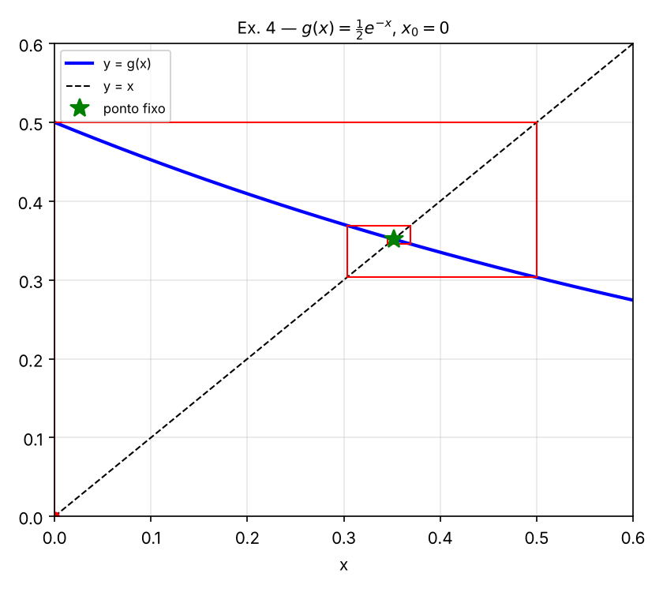
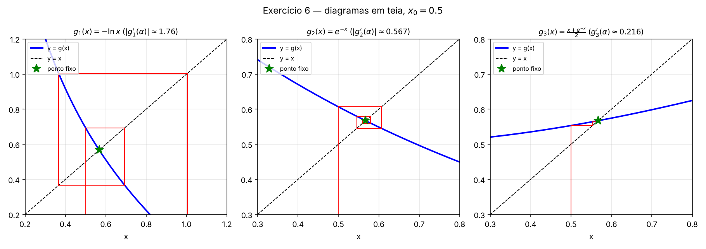
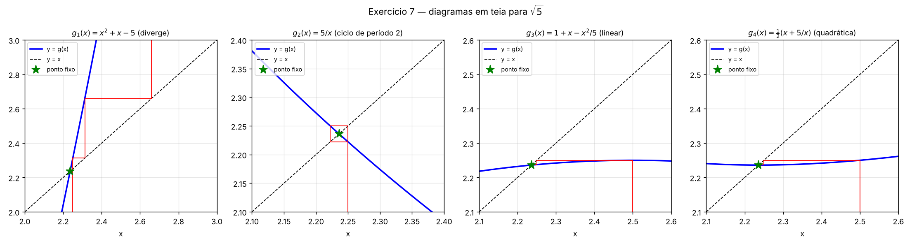

# Equações não lineares — Método do Ponto Fixo (MPF)
Exercícios resolvidos: **4; 6; 7**

[[ExerciciosEquacoesNaoLineares.pdf]] · [[EquacoesNaoLineares.pdf]]

## 0. Resumo teórico (para consulta)

### Ideia do método

Transformar $f(x)=0$ numa equação equivalente $g(x)=x$ (problema de **ponto fixo**) e iterar

$$x_{k+1}=g(x_k),\qquad k=0,1,2,\dots$$

Exemplo (slides): $x^2-x-2=0\iff x=x^2-2\ \ (g_1)\iff x=\sqrt{x+2}\ \ (g_2)\iff x=1+\tfrac2x\ \ (g_3)$ — **várias funções iterativas** para a mesma equação, com comportamentos muito diferentes.

### Função contrativa e teorema do ponto fixo (Banach)

- $g$ é **contrativa** em $D$ se $\exists\,0\le L<1$: $\;|g(x)-g(y)|\le L|x-y|,\ \forall x,y\in D$ ($L$ = constante de Lipschitz).
- **Critério prático:** se $g\in C^1[a,b]$ e $\;L=\max_{x\in[a,b]}|g'(x)|<1$, então $g$ é contrativa em $[a,b]$ com constante $L$.

**Teorema (Banach):** seja $I$ um intervalo fechado, $g(I)\subseteq I$ e $g$ contrativa em $I$ com constante $L$. Então:

1. para qualquer $x_0\in I$ a sucessão $x_{k+1}=g(x_k)$ converge para um $\alpha\in I$;
2. $\alpha$ é ponto fixo de $g$ e é o **único** ponto fixo de $g$ em $I$ (logo, único zero de $f$ em $I$);
3. o erro $e_k=\alpha-x_k$ satisfaz

$$\underbrace{|e_k|\le\frac{L}{1-L}\,|x_k-x_{k-1}|}_{\text{estimativa a posteriori}}\qquad\underbrace{|e_k|\le\frac{L^k}{1-L}\,|x_1-x_0|}_{\text{estimativa a priori}}$$

**Passos para aplicar:** (i) escolher $I$ onde exista o zero; (ii) provar $g(I)\subseteq I$ (estudar monotonia de $g$ e calcular $g$ nos extremos); (iii) calcular $L=\max_I|g'|<1$.

### Convergência local e ordem de convergência

Seja $\alpha$ ponto fixo de $g$, com $g$ de classe $C^1$ perto de $\alpha$:

$$
\begin{array}{|l|l|}
\hline
\textbf{Condição} & \textbf{Conclusão} \\ \hline
\lvert g'(\alpha)\rvert<1 & \begin{array}{l} \text{converge localmente (}x_0 \\ \text{suficientemente perto de}\ \alpha\text{)} \end{array} \\ \hline
\lvert g'(\alpha)\rvert>1 & \begin{array}{l} \textbf{não converge}\ \text{(por mais perto que} \\ x_0\ \text{esteja de}\ \alpha\text{)} \end{array} \\ \hline
\lvert g'(\alpha)\rvert=1 & \text{nada se pode concluir à partida} \\ \hline
0<\lvert g'(\alpha)\rvert<1 & \begin{array}{l} \text{convergência}\ \textbf{linear}\text{:} \\ \displaystyle\lim\dfrac{\lvert e_{k+1}\rvert}{\lvert e_k\rvert}=\lvert g'(\alpha)\rvert \end{array} \\ \hline
g'(\alpha)=\dots=g^{(p-1)}(\alpha)=0\text{,}\ g^{(p)}(\alpha)\ne0 & \text{ordem}\ p\text{:}\ \displaystyle\lim\dfrac{\lvert e_{k+1}\rvert}{\lvert e_k\rvert^p}=\dfrac{\lvert g^{(p)}(\alpha)\rvert}{p!} \\ \hline
\end{array}
$$

*(Quanto menor $|g'(\alpha)|$, mais rápida é a convergência.)*

### Critérios de paragem e código

Critérios habituais: $|x_{k+1}-x_k|<\varepsilon_1$; $\;|x_{k+1}-x_k|<\varepsilon_2|x_{k+1}|$; $\;|f(x_k)|<\varepsilon_3$; e **sempre** $k\le k_{\max}$.

```m
function [alfa,iteradas,est_erros] = metPontoFixo(g,x0,tol,maxit)
iteradas = zeros(maxit,1); est_erros = zeros(maxit,1);
for niter = 1:maxit
    nova_iterada = g(x0);                  % nova aproximação
    iteradas(niter) = nova_iterada;
    est = abs(nova_iterada - x0);          % estimativa do erro: |x_k - x_{k-1}|
    est_erros(niter) = est;
    if est < tol, break, end
    x0 = nova_iterada;
end
if (niter == maxit && est >= tol)
    warning('não se atingiu a precisão desejada')
else
    iteradas(niter+1:end) = []; est_erros(niter+1:end) = [];
    alfa = iteradas(end);
end
```

> A estimativa implementada, $|x_k-x_{k-1}|$, é um **majorante** do erro quando $L\le\tfrac12$ (porque $\frac L{1-L}\le1$). Para $L>\tfrac12$ pode não ser fiável.

---

## 4)

**Enunciado:** $x-\tfrac12e^{-x}=0$.

### a) Raiz única $\alpha\in I=[0,\tfrac12]$

$f(x)=x-\frac12e^{-x}$ é contínua e

$$f(0)=-\tfrac12<0,\qquad f\!\left(\tfrac12\right)=\tfrac12-\tfrac12e^{-1/2}\approx0.197>0$$

⟹ (TVI) existe pelo menos uma raiz em $(0,\frac12)$. Unicidade: $f'(x)=1+\frac12e^{-x}>0$ ⟹ $f$ estritamente crescente ⟹ **uma única raiz** $\alpha\in[0,\frac12]$.

### b) Convergência de $x_{k+1}=\frac12e^{-x_k}$ para qualquer $x_0\in I$

A equação é equivalente a $g(x)=x$ com $g(x)=\frac12e^{-x}$. Verifica-se o teorema de Banach em $I=[0,\frac12]$:

- **$g(I)\subseteq I$:** $g'(x)=-\frac12e^{-x}<0$ ⟹ $g$ decrescente; $g(0)=\frac12$ e $g(\frac12)=\frac12e^{-1/2}\approx0.303$ ⟹ $g(I)=[0.303,\,0.5]\subseteq[0,\frac12]$ ✓
- **Contrativa:** $|g'(x)|=\frac12e^{-x}\le\frac12$ em $I$ (máximo em $x=0$) ⟹ $L=\max_I|g'|=\dfrac12<1$ ✓

Logo, pelo teorema do ponto fixo, a sucessão converge para $\alpha$ (único ponto fixo de $g$ em $I$) **qualquer que seja $x_0\in I$**. $\blacksquare$

### c) Com $x_0=0$: $|\alpha-x_k|\le(\tfrac12)^k$

$x_1=g(0)=\frac12$, logo $|x_1-x_0|=\frac12$. Pela estimativa a priori com $L=\frac12$:

$$|\alpha-x_k|\le\frac{L^k}{1-L}\,|x_1-x_0|=\frac{(1/2)^k}{1/2}\cdot\frac12=\left(\frac12\right)^k\qquad\blacksquare$$

### d) 8 iterações com $x_0=0$

```m
g = @(x) 0.5*exp(-x);
x = zeros(9,1);               % x(1) = x_0
for k = 1:8
    x(k+1) = g(x(k));
end
format long
x(2:end)
alfa_ref = fzero(@(x) x - 0.5*exp(-x), [0 0.5])     % 0.351733711249196
```

$$
\begin{array}{|l|l|l|l|l|}
\hline
k & x_k & \lvert x_k-x_{k-1}\rvert & \lvert\alpha-x_k\rvert & \textbf{cota a priori}\ (\dfrac12)^k \\ \hline
\text{0} & \text{0} & \text{—} & \text{—} & \text{—} \\ \hline
\text{1} & \text{0.500000} & 5.0\times10^{-1} & 1.483\times10^{-1} & \text{0.5} \\ \hline
\text{2} & \text{0.303265} & 1.967\times10^{-1} & 4.847\times10^{-2} & \text{0.25} \\ \hline
\text{3} & \text{0.369202} & 6.594\times10^{-2} & 1.747\times10^{-2} & \text{0.125} \\ \hline
\text{4} & \text{0.345643} & 2.356\times10^{-2} & 6.091\times10^{-3} & \text{0.0625} \\ \hline
\text{5} & \text{0.353883} & 8.240\times10^{-3} & 2.149\times10^{-3} & \text{0.03125} \\ \hline
\text{6} & \text{0.350979} & 2.904\times10^{-3} & 7.550\times10^{-4} & \text{0.015625} \\ \hline
\text{7} & \text{0.351999} & 1.021\times10^{-3} & 2.657\times10^{-4} & \text{0.0078125} \\ \hline
\text{8} & \textbf{0.351640} & 3.591\times10^{-4} & 9.343\times10^{-5} & \text{0.00390625} \\ \hline
\end{array}
$$

$$\boxed{\alpha\approx x_8=0.351640}$$

- Cota a priori: $|\alpha-x_8|\le(\frac12)^8\approx3.9\times10^{-3}$ (pessimista).
- Cota a posteriori: $|\alpha-x_8|\le\frac{L}{1-L}|x_8-x_7|=|x_8-x_7|\approx3.6\times10^{-4}$ (como $L=\frac12$, a estimativa $|x_k-x_{k-1}|$ é majorante) ⟹ **3 c.d. corretas**: $\alpha\approx0.352$ (erro efetivo $9.3\times10^{-5}$).
- Repara que a sucessão **oscila** em torno de $\alpha$ (porque $g'<0$): $0.30,\,0.37,\,0.35\ldots$



```m
function teia(g, x0, n, a, b)      % diagrama em teia (cobweb) do método do ponto fixo
xx = linspace(a, b, 400);
figure; hold on; grid on
plot(xx, g(xx), 'b', 'LineWidth', 2)       % y = g(x)
plot(xx, xx, 'k--')                         % y = x
x = x0; plot(x0, 0, 'ro')
plot([x x], [0 g(x)], 'r')
for k = 1:n
    y = g(x);
    plot([x y], [y y], 'r')                 % horizontal até y = x
    plot([y y], [y g(y)], 'r')              % vertical até à curva
    x = y;
end
xlabel('x'); legend('y = g(x)', 'y = x')
end
% uso:  teia(@(x) 0.5*exp(-x), 0, 6, 0, 0.6)
```

---

## 6)

**Enunciado:** $\dfrac1x-e^x=0$, única raiz $\alpha$ perto de $0.5$.

### a) Quais esquemas podem ser usados? Qual deve ser usado?

Todos têm $\alpha$ como ponto fixo (são equivalentes à equação: $\frac1x=e^x\iff x=-\ln x\iff x=e^{-x}$; o terceiro é a média de $x$ e $e^{-x}$). Falta ver se **convergem**: condição $|g'(\alpha)|<1$. Valor da raiz: $\alpha\approx0.567143$ (satisfaz $e^{-\alpha}=\alpha$).

$$
\begin{array}{|l|l|l|l|}
\hline
\textbf{Esquema} & g'(x) & g'(\alpha) & \textbf{Conclusão} \\ \hline
g_1(x)=-\ln x & -\dfrac1x & -\dfrac1\alpha\approx-1.763 & \lvert g_1'(\alpha)\rvert>1\ \Rightarrow \ \textbf{não converge} \\ \hline
g_2(x)=e^{-x} & -e^{-x} & -e^{-\alpha}=-\alpha\approx-0.567 & <1\ \Rightarrow \text{ converge (linear, lenta)} \\ \hline
g_3(x)=\dfrac{x+e^{-x}}2 & \dfrac{1-e^{-x}}2 & \dfrac{1-\alpha}2\approx0.216 & \begin{array}{l} <1\ \Rightarrow \text{ converge (linear,}\ \textbf{mais} \\ \textbf{rápida}\text{)} \end{array} \\ \hline
\end{array}
$$

⟹ $g_1$ não pode ser usada; $g_2$ e $g_3$ podem, e **deve usar-se $g_3$** (menor $|g'(\alpha)|$ ⟹ menor constante assintótica ⟹ menos iterações).

*(Para aplicar Banach rigorosamente, p.ex. $I=[0.5,0.65]$: $g_2(I)=[0.522,0.607]\subseteq I$ com $L=e^{-0.5}\approx0.607$; $g_3$ é crescente, $g_3(I)=[0.553,0.586]\subseteq I$ com $L=g_3'(0.65)\approx0.239$.)*



### b) Confirmação com `metPontoFixo` ($x_0=0.5$, $tol=0.5\times10^{-4}$, $maxit=50$)

```m
g1 = @(x) -log(x);
g2 = @(x) exp(-x);
g3 = @(x) (x + exp(-x))/2;

[alfa2, it2, est2] = metPontoFixo(g2, 0.5, 0.5e-4, 50);
[alfa3, it3, est3] = metPontoFixo(g3, 0.5, 0.5e-4, 50);
metPontoFixo(g1, 0.5, 0.5e-4, 50);       % não converge → aviso
```

$$
\begin{array}{|l|l|}
\hline
\textbf{Esquema} & \textbf{Resultado} \\ \hline
g_1 & \begin{array}{l} \textbf{Não converge.}\ \text{Iteradas:} \\ 0.5,\ 0.6931,\ 0.3665,\ 1.0037,\ -0.0037,\ldots \\ \text{— a partir da iteração 5,}\ x_k<0\ \text{e o} \\ \text{logaritmo passa a ser complexo; o} \\ \text{critério nunca é satisfeito em 50} \\ \text{iterações (aviso \textquotedblleft{}não se atingiu a} \\ \text{precisão desejada\textquotedblright{}).} \end{array} \\ \hline
g_2 & \begin{array}{l} \text{Converge em}\ \textbf{15 iterações}\text{:} \\ x_{15}=0.567157 \end{array} \\ \hline
g_3 & \begin{array}{l} \text{Converge em}\ \textbf{6 iterações}\text{:} \\ x_6=0.567137 \end{array} \\ \hline
\end{array}
$$

(Na versão dos slides, quando se esgotam as iterações só é emitido o aviso; para ver as iteradas de $g_1$ usa um ciclo `for`.)

### c) Qualidade da estimativa $|x_k-x_{k-1}|$ do erro

```m
alfa_ref = fzero(@(x) 1./x - exp(x), 0.5)        % 0.567143290409784
erros2 = abs(alfa_ref - it2);
erros3 = abs(alfa_ref - it3);
[it3  est3  erros3  est3./erros3]                 % comparar estimativa vs erro real
```

**$g_3$ (todas as iterações):**

$$
\begin{array}{|l|l|l|l|l|}
\hline
k & x_k & \textbf{Estimativa}\ \lvert x_k-x_{k-1}\rvert & \textbf{Erro real}\ \lvert\alpha-x_k\rvert & \textbf{Estimativa / erro} \\ \hline
\text{1} & \text{0.553265} & 5.327\times10^{-2} & 1.388\times10^{-2} & \text{3.84} \\ \hline
\text{2} & \text{0.564167} & 1.090\times10^{-2} & 2.976\times10^{-3} & \text{3.66} \\ \hline
\text{3} & \text{0.566500} & 2.333\times10^{-3} & 6.429\times10^{-4} & \text{3.63} \\ \hline
\text{4} & \text{0.567004} & 5.038\times10^{-4} & 1.391\times10^{-4} & \text{3.62} \\ \hline
\text{5} & \text{0.567113} & 1.090\times10^{-4} & 3.010\times10^{-5} & \text{3.62} \\ \hline
\text{6} & \text{0.567137} & 2.358\times10^{-5} & 6.514\times10^{-6} & \text{3.62} \\ \hline
\end{array}
$$

**$g_2$ (algumas iterações das 15):**

$$
\begin{array}{|l|l|l|l|l|}
\hline
k & x_k & \textbf{Estimativa}\ \lvert x_k-x_{k-1}\rvert & \textbf{Erro real}\ \lvert\alpha-x_k\rvert & \textbf{Estimativa / erro} \\ \hline
\text{1} & \text{0.606531} & 1.065\times10^{-1} & 3.939\times10^{-2} & \text{2.71} \\ \hline
\text{2} & \text{0.545239} & 6.129\times10^{-2} & 2.190\times10^{-2} & \text{2.80} \\ \hline
\text{5} & \text{0.571172} & 1.111\times10^{-2} & 4.029\times10^{-3} & \text{2.76} \\ \hline
\text{10} & \text{0.566907} & 6.524\times10^{-4} & 2.361\times10^{-4} & \text{2.76} \\ \hline
\text{15} & \text{0.567157} & 3.828\times10^{-5} & 1.385\times10^{-5} & \text{2.76} \\ \hline
\end{array}
$$

**Comentários:**

- Em ambos os casos a estimativa $|x_k-x_{k-1}|$ é **maior** que o erro real ⟹ é fiável (majorante), embora pessimista (3.6 vezes maior em $g_3$, 2.8 vezes em $g_2$).
- Porquê: com $e_{k+1}\approx\lambda e_k$ ($\lambda=g'(\alpha)$), tem-se $x_k-x_{k-1}=e_{k-1}-e_k\approx e_k\left(\frac1\lambda-1\right)$, logo

$$\frac{\text{estimativa}}{\text{erro real}}\approx\left|\frac1\lambda-1\right|\quad\Rightarrow\quad g_3:\ \left|\tfrac1{0.2164}-1\right|=3.62\ ✓\qquad g_2:\ \left|\tfrac1{-0.5671}-1\right|=2.76\ ✓$$

- A estimativa **subestima** o erro quando $|1/\lambda-1|<1$, isto é, para $\lambda>\frac12$ (convergência monótona, $g'>0$). Para $g_2$ ($\lambda<0$, iteradas alternadas) isso nunca acontece; para $g_3$ ($\lambda=0.216<\frac12$) também não. Por isso aqui é fiável — mas com um $g$ com $g'(\alpha)=0.9$, por exemplo, o erro real seria ≈ 9 vezes **maior** que a estimativa.
- A razão dos erros $\lvert e_{k+1}\rvert/\lvert e_k\rvert$ aproxima-se de $0.567$ ($g_2$) e de $0.216$ ($g_3$), isto é, $\lvert g'(\alpha)\rvert$ ✓ (convergência linear).

---

## 7)

**Enunciado:** raiz positiva de $x^2-5=0$ ($\alpha=\sqrt5=2.2360679775$) com `metPontoFixo` e `tol` $=0.5\times10^{-8}$.

> O enunciado não indica `maxit`; usei $maxit=50$ (os casos que divergem falham antes disso).

```m
tol = 0.5e-8;
g1 = @(x) x.^2 + x - 5;
g2 = @(x) 5./x;
g3 = @(x) 1 + x - x.^2/5;
g4 = @(x) 0.5*(x + 5./x);

metPontoFixo(g1, 2.25, tol, 50)  ,  metPontoFixo(g1, 2.2, tol, 50)       % a)
metPontoFixo(g2, 2.25, tol, 50)  ,  metPontoFixo(g2, 2.2, tol, 50)       % b)
[alfa3, it3, est3] = metPontoFixo(g3, 2.5, tol, 50)                      % c)
[alfa4, it4, est4] = metPontoFixo(g4, 2.5, tol, 50)                      % d)
```

Derivadas em $\alpha=\sqrt5$:

$$
\begin{array}{|l|l|l|l|}
\hline
\textbf{Função} & g'(x) & g'(\sqrt5) & \textbf{Previsão} \\ \hline
g_1=x^2+x-5 & 2x+1 & 2\sqrt5+1\approx5.47 & >1\text{: diverge} \\ \hline
g_2=5/x & -5/x^2 & -1 & \lvert g'\rvert=1\text{: inconclusivo} \\ \hline
g_3=1+x-x^2/5 & 1-2x/5 & 1-\dfrac{2}{\sqrt5}\approx0.1056 & \text{converge (linear)} \\ \hline
g_4=\dfrac12(x+5/x) & \dfrac12(1-5/x^2) & 0 & \text{converge (ordem}\ \ge2\text{)} \\ \hline
\end{array}
$$



### a) $g_1(x)=x^2+x-5$, $x_0=2.25$ e $x_0=2.2$

**Diverge** nos dois casos (não é só "não converge": explode), apesar de $x_0$ estar muito perto de $\alpha$:

- $x_0=2.25$: $2.25,\ 2.3125,\ 2.6602,\ 4.7366,\ 22.17,\ 508.8,\ 2.6\times10^5,\ \ldots$ → `Inf` na iteração 12 (a função falha com *"A iteração falhou"*).
- $x_0=2.2$: $2.2,\ 2.04,\ 1.2016,\ -2.3546,\ -1.8106,\ -3.5323,\ 3.9447,\ 14.5,\ 219.9,\ \ldots$ → `Inf` na iteração 16.

Como $|g_1'(\alpha)|\approx5.47>1$, $|e_{k+1}|\approx5.47\,|e_k|$ perto de $\alpha$: o erro **amplifica-se** em cada passo (as iteradas afastam-se de $\alpha$ — para cima com $2.25$, para baixo com $2.2$).

### b) $g_2(x)=5/x$, $x_0=2.25$ e $x_0=2.2$

**Não converge:** as iteradas ficam a **oscilar entre dois valores** (ciclo de período 2):

- $x_0=2.25$: $2.25,\ 2.2222,\ 2.25,\ 2.2222,\ \ldots$
- $x_0=2.2$: $2.2,\ 2.2727,\ 2.2,\ 2.2727,\ \ldots$

Porquê: $g_2(g_2(x))=\dfrac{5}{5/x}=x$ — aplicar $g_2$ duas vezes devolve $x_0$. Com $|g_2'(\alpha)|=1$ o teorema não garante convergência, e aqui realmente não há (o critério $|x_k-x_{k-1}|<tol$ nunca é satisfeito: a diferença fica constante, $0.0278$ e $0.0727$, e a função esgota `maxit`). O ponto fixo $\sqrt5$ está "no meio" do ciclo.

### c) $g_3(x)=1+x-\frac{x^2}5$, $x_0=2.5$

Converge em **9 iterações**, $x_9=2.2360679777$ (erro $2.1\times10^{-10}$). Convergência **linear**:

$$
\begin{array}{|l|l|l|l|l|}
\hline
k & x_k & \lvert x_k-x_{k-1}\rvert & \lvert\alpha-x_k\rvert & e_k/e_{k-1} \\ \hline
\text{1} & \text{2.250000000} & 2.500\times10^{-1} & 1.393\times10^{-2} & \text{—} \\ \hline
\text{2} & \text{2.237500000} & 1.250\times10^{-2} & 1.432\times10^{-3} & \text{0.1028} \\ \hline
\text{3} & \text{2.236218750} & 1.281\times10^{-3} & 1.508\times10^{-4} & \text{0.1053} \\ \hline
\text{4} & \text{2.236083890} & 1.349\times10^{-4} & 1.591\times10^{-5} & \text{0.1055} \\ \hline
\text{5} & \text{2.236069657} & 1.423\times10^{-5} & 1.680\times10^{-6} & \text{0.1056} \\ \hline
\text{6} & \text{2.236068155} & 1.503\times10^{-6} & 1.774\times10^{-7} & \text{0.1056} \\ \hline
\text{7} & \text{2.236067996} & 1.586\times10^{-7} & 1.872\times10^{-8} & \text{0.1056} \\ \hline
\text{8} & \text{2.236067979} & 1.675\times10^{-8} & 1.977\times10^{-9} & \text{0.1056} \\ \hline
\text{9} & \text{2.236067978} & 1.768\times10^{-9} & 2.087\times10^{-10} & \text{0.1056} \\ \hline
\end{array}
$$

A razão $e_k/e_{k-1}\to0.1056=g_3'(\sqrt5)=1-\frac2{\sqrt5}$ ✓ — cada iteração ganha cerca de **1 casa decimal** ($\log_{10}(1/0.1056)\approx0.98$). Como $L\approx0.106<\frac12$, a estimativa $|x_k-x_{k-1}|$ é um majorante do erro (e aqui é cerca de 8.5 vezes maior).

### d) $g_4(x)=\frac12\left(x+\frac5x\right)$, $x_0=2.5$

Converge em apenas **4 iterações**, com ordem de convergência **2** (quadrática):

$$
\begin{array}{|l|l|l|l|l|}
\hline
k & x_k & \lvert x_k-x_{k-1}\rvert & \lvert\alpha-x_k\rvert & \lvert e_k\rvert/e_{k-1}^2 \\ \hline
\text{1} & \text{2.250000000000} & 2.500\times10^{-1} & 1.393\times10^{-2} & \text{0.2000} \\ \hline
\text{2} & \text{2.236111111111} & 1.389\times10^{-2} & 4.313\times10^{-5} & \text{0.2222} \\ \hline
\text{3} & \text{2.236067977916} & 4.313\times10^{-5} & 4.160\times10^{-10} & \text{0.2236} \\ \hline
\text{4} & \text{2.236067977500} & 4.160\times10^{-10} & \approx10^{-16} & \text{—} \\ \hline
\end{array}
$$

Justificação teórica: $g_4'(x)=\frac12\left(1-\frac5{x^2}\right)\Rightarrow g_4'(\sqrt5)=0$ e $g_4''(x)=\frac5{x^3}\Rightarrow g_4''(\sqrt5)=\frac1{\sqrt5}\ne0$. Logo a ordem é $p=2$ com constante

$$C=\frac{\lvert g_4''(\alpha)\rvert}{2!}=\frac{1}{2\sqrt5}\approx0.2236$$

e a tabela confirma $\lvert e_k\rvert/e_{k-1}^2\to0.2236$ ✓. O número de algarismos corretos **duplica** em cada iteração ($1.4\times10^{-2}\to4.3\times10^{-5}\to4.2\times10^{-10}\to\sim10^{-16}$). (Este é o método de Newton aplicado a $x^2-5$ — "método de Heron" para raízes quadradas.)

```m
[alfa3, it3, est3] = metPontoFixo(g3, 2.5, tol, 50);
e3 = sqrt(5) - it3;   e3(2:end)./e3(1:end-1)              % → 0.1056

[alfa4, it4, est4] = metPontoFixo(g4, 2.5, tol, 50);
e4 = sqrt(5) - it4;   abs(e4(2:3)./e4(1:2).^2)            % → 0.2222  0.2236
```

